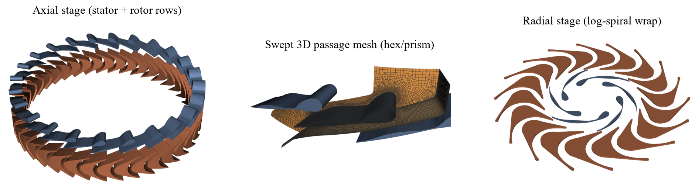
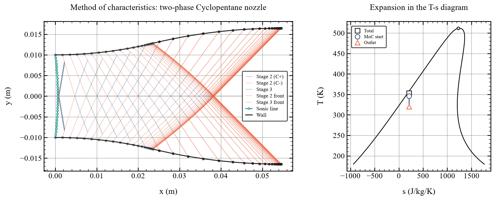
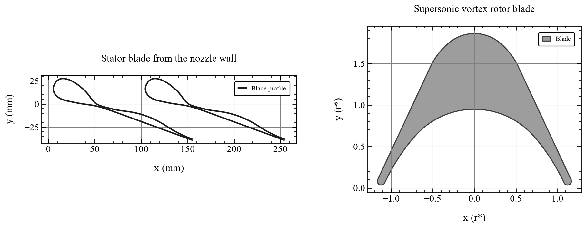
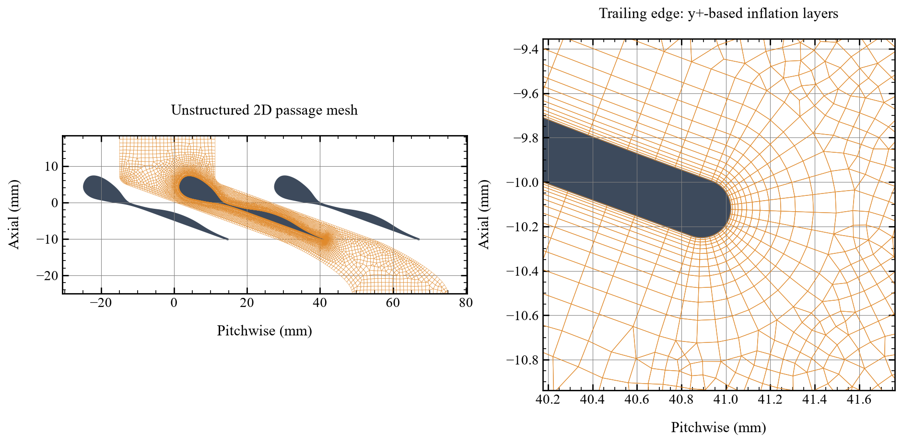

**From a real-fluid supersonic nozzle to a meshed turbine stage, in one Python package.**

TurboMoC designs supersonic nozzles with the method of characteristics (MoC)
using real-fluid thermodynamics, including two-phase flashing and condensing
expansions under the Homogeneous Equilibrium Model (HEM). Its current design
app turns a MoC stator profile into a linear cascade or an axial/radial row,
then generates independent section and volume meshes with quality reports
and CGNS export. The Python library and preserved preceding app also provide
vortex rotor design, sizing, CAD and stage-assembly tools. These legacy tools
have not yet been integrated into the row-based interface; its rotor controls
remain explicit planning placeholders.

📦 **PyPI package**: [https://pypi.org/project/turbo_moc/](https://pypi.org/project/turbo_moc/)

📚 **Documentation**: [https://turbo-sim.github.io/TurboMoC/](https://turbo-sim.github.io/TurboMoC/)

🎓 **Tutorials**: [https://turbo-sim.github.io/TurboMoC/examples/index.html](https://turbo-sim.github.io/TurboMoC/examples/index.html)



## Features

### Nozzle design with the method of characteristics

- Conventional and minimum-length nozzles for single-phase and two-phase (HEM) flows.
- Real-fluid properties through [jaxprop](https://pypi.org/project/jaxprop/)/CoolProp, including
  wet inlets (vapor quality) and expansions crossing the saturation dome.
- Smooth sonic transition, kernel and reflex regions, with axis and wall property distributions.



### Blade design

- **Stator**: the nozzle wall becomes a B-spline blade with prescribed inlet/outlet metal angles,
  trailing-edge radius and throat, editable control point by control point.
- **Rotor**: supersonic vortex blades (Goldman's method, generalized to real gases), impulse or
  reacting, optionally coupled to the stator exit state.



### Sizing, CAD and stages in the preserved workflow

- Size the stator for a mass flow and blade count; the rotor shares its annulus.
- **Axial** rows wrap onto the annulus between hub and shroud; **radial** rows use an
  angle-preserving log-spiral map, with the blade count and outer radius chosen so that the
  radial passage is exactly the one designed in 2D.
- Assemble stator and rotor rows into a stage and export STEP/STL solids.

### Meshing for CFD

- The canonical pipeline generates a periodic 2D reference mesh with Gmsh,
  inflation layers and controlled core grading, then deforms and sweeps its
  shared connectivity into hexahedral/prismatic volumes.
- General meridional mapping serves axial/radial stators. Linear cascades use
  physical section coordinates and translational extrusion, with both true
  2D export and an optional one-element-span volume.
- Geometry and meshing are separate actions; reference/volume validity,
  periodicity, quality and CGNS connectivity are audited before publication.
- The preserved legacy workflow retains structured O-H topology, sizing from
  target $y^+$, stator/rotor axial/radial meshes and original guarded cell
  repairs. Those capabilities remain available under `turbo_moc.deprecated`;
  they are not silently activated in the canonical pipeline.



### Interactive app and workflows

- The current Dash app has **Geometry generation** and **Mesh generation**
  workspaces, ordered row settings, shared machine views, selected-row
  section/report views and a live terminal for local background jobs.
- The preceding Nozzle/Stator/Rotor/Cascade app remains runnable through its
  established entry point. Its diagnostics, reference tools, control-point
  editing, sizing, CAD and rotor capabilities are preserved.
- Thin scripted workflows and editable cases live under
  [`examples/`](examples/readme.md):
  [Gmsh 2D](examples/gmsh_2D/readme.md),
  [Gmsh 3D](examples/gmsh_3D/readme.md) and
  [Fluent 2D automation](examples/fluent_2D/readme.md).

The [merging summary](z_information/merging_summary.md) records the canonical/deprecated
module map, complete interface feature matrix and remaining integration work.
The [teaching guide](z_information/theory_guide.md) derives the coordinate
mapping, mesh deformation, connectivity and CGNS export.

## Installation instructions

TurboMoC requires Python 3.11, 3.12, or 3.13.

### Install from PyPI

Install with pip in your Python environment:

```bash
python -m pip install --upgrade "turbo_moc[cad]"
```

The `cad` extra installs CadQuery (STEP/STL export) and the app's 3D viewer. Gmsh is always
installed.

To install TurboMoC from PyPI into an existing [Poetry](https://python-poetry.org/docs/cli/#add)
project, use `poetry add` with bracket notation for optional extras:

```bash
poetry add "turbo_moc[cad]"
```

Include the `fluent` extra to install optional PyFluent support alongside CAD:

```bash
poetry add "turbo_moc[cad,fluent]"
```

Use `"turbo_moc[fluent]"` if you only need the Fluent extra. Poetry records the
selected extras in your project's dependencies and installs them from PyPI.

### Install from source

With [Poetry](https://python-poetry.org/docs/#installation), clone the repository and install the package with CAD support:

```bash
git clone https://github.com/turbo-sim/TurboMoC.git
cd TurboMoC
poetry install --extras cad
```

For CAD and Fluent support in the source checkout, use:

```bash
poetry install --extras "cad fluent"
```

The `fluent` extra installs the Python interface; Fluent must be installed and
licensed separately. See the [Fluent workflow README](examples/fluent_2D/readme.md)
for the companion barotropy installation and example configuration.

Use `poetry run python` to run Python scripts in the Poetry environment.

Gmsh, PyVista and Dash VTK are installed by default for the geometry/meshing app:

```bash
poetry install
# Alternatively:
python -m pip install -e .
```

Package promotion described here applies to this checkout; publishing a new
PyPI release is a separate step. CAD and Fluent dependencies remain optional.


## Quick start

Save the following as `quick_start.py` and run `python quick_start.py` (or `poetry run python quick_start.py` for a source installation). It designs a CO₂ expansion nozzle, prints the convergence status and exit Mach number, and displays the characteristics mesh with Matplotlib.

The conditions are representative of a transcritical CO₂ heat pump: the nozzle
expands CO₂ from a gas-cooler outlet at 35 °C and 1.2 times the critical pressure
(about 88.5 bar) to the saturation pressure at an evaporation temperature of 5 °C
(about 39.7 bar).

```python
import jaxprop as jxp
import matplotlib.pyplot as plt
from turbo_moc import design_nozzle, mpl

fluid = jxp.Fluid("CO2")
inlet_pressure = 1.2 * fluid.critical_point.p  # Pa
inlet_temperature = 273.15 + 35.0  # K; gas-cooler outlet at 35 °C
evaporation_temperature = 273.15 + 5.0  # K (5 °C)
back_pressure = fluid.get_state(jxp.QT_INPUTS, 0, evaporation_temperature).p

result = design_nozzle(
    fluid_name="CO2",
    P0=inlet_pressure,
    T0=inlet_temperature,  # K
    p_back=back_pressure,  # Pa; saturation pressure at 5 °C
    solver="conventional",
)

print(f"Converged: {result['converged']}")
print(f"Exit Mach number: {result['exit_M']:.4f}")

fig, ax = mpl.plot_characteristics_mesh(result, mirror=True)
plt.show()
```

See the [worked examples](https://turbo-sim.github.io/TurboMoC/examples/index.html)
for nozzle, stator, and rotor design, including plots and coordinate exports.

## Interactive app

Launch the app:

```bash
turbo_moc-app
```

For a Poetry installation, prefix the commands with `poetry run`. Open the local
URL printed in the terminal (port 8052 by default). Example app YAML files are available in `examples/apps/cases/`.

