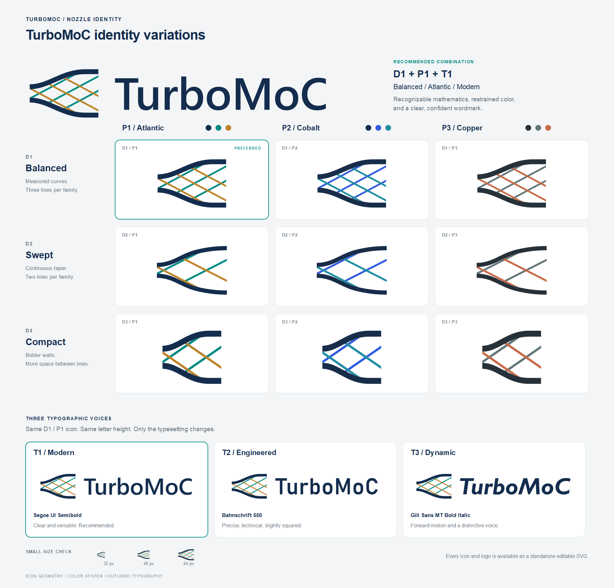

# TurboMoC logo review

Choose a **nozzle design (D)**, **color palette (P)**, and **text style (T)**.

[Open the full-size comparison](overview.png). The matrix compares three nozzle designs across three palettes. The three complete logos underneath use the same D1/P1 icon and equal letter heights, so the text styles can be compared fairly.

## Recommended choice

**D1 Balanced + P1 Atlantic + T1 Modern** combines a recognizable characteristic mesh, restrained teal and brass, and clear upright lettering.

Open the recommended [icon](d1-balanced-p1-atlantic.svg) and [complete logo](t1-modern.svg). For smaller placements, consider [D3 Compact](d3-compact-p1-atlantic.svg).

## Nozzle designs

| Design | Visual character | Best use |
| --- | --- | --- |
| **D1 · Balanced** | Smooth walls and three lines per characteristic family | Main package identity; clearest connection to the method of characteristics |
| **D2 · Swept** | Continuous wall curvature and two lines per family | A lighter, more fluid appearance |
| **D3 · Compact** | Shorter proportions, thicker walls, and wider line spacing | Small icons and compact placements |

The crossing lines symbolize characteristic directions; these are stylized nozzle emblems rather than calculated flow diagrams.

## Palettes and icon files

| Palette | Colors | Impression |
| --- | --- | --- |
| **P1 · Atlantic** | Navy, deep teal, muted brass | Calm and distinctive; recommended |
| **P2 · Cobalt** | Navy, cobalt, blue teal | Cool and technical |
| **P3 · Copper** | Graphite, slate, copper | Restrained with a warmer accent |

| Design | P1 · Atlantic | P2 · Cobalt | P3 · Copper |
| --- | --- | --- | --- |
| D1 · Balanced | [D1/P1](d1-balanced-p1-atlantic.svg) | [D1/P2](d1-balanced-p2-cobalt.svg) | [D1/P3](d1-balanced-p3-copper.svg) |
| D2 · Swept | [D2/P1](d2-swept-p1-atlantic.svg) | [D2/P2](d2-swept-p2-cobalt.svg) | [D2/P3](d2-swept-p3-copper.svg) |
| D3 · Compact | [D3/P1](d3-compact-p1-atlantic.svg) | [D3/P2](d3-compact-p2-cobalt.svg) | [D3/P3](d3-compact-p3-copper.svg) |

## Complete logos with text

| Logo | Typesetting | Impression |
| --- | --- | --- |
| **[T1 · Modern](t1-modern.svg)** | Segoe UI Semibold | Clear, balanced, and versatile; recommended |
| **[T2 · Engineered](t2-engineered.svg)** | Bahnschrift, weight 550 | Precise, slightly squared, and technical |
| **[T3 · Dynamic](t3-dynamic.svg)** | Gill Sans MT Bold Italic | Expressive and energetic, suggesting acceleration |

All three pair **TurboMoC** with the D1/P1 nozzle. Lettering is stored as vector outlines, so no fonts need to be installed.

## Reviewing the artwork

Open any SVG in a browser to inspect it at full size. The artwork has transparent backgrounds and is intended for light surfaces. Check D1 at 48 px or larger to preserve its mesh detail; D3 is the better starting point for smaller icons.

This folder contains only **nine icon SVGs, three complete logo SVGs, the comparison image, and this guide**.
