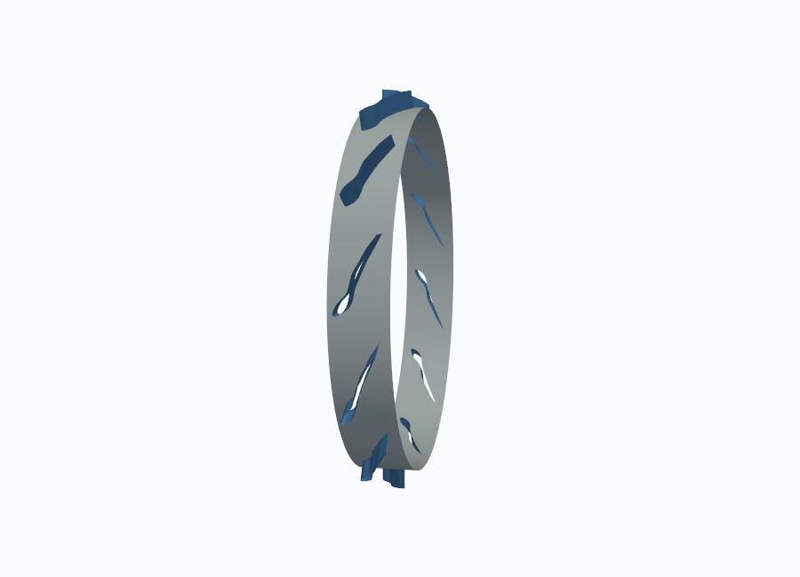
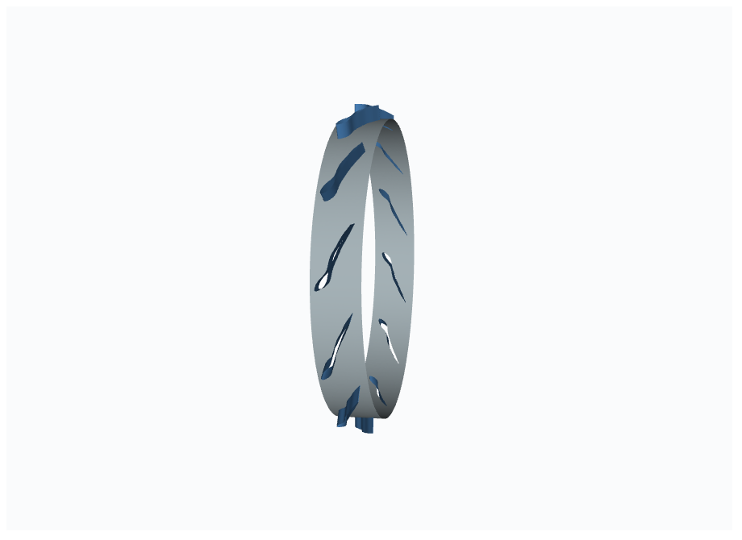
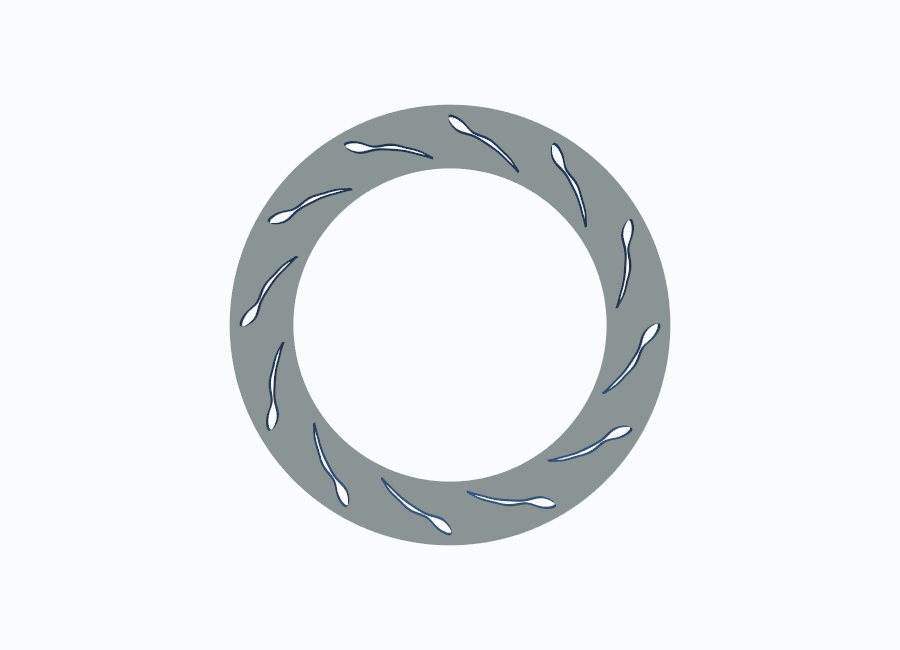
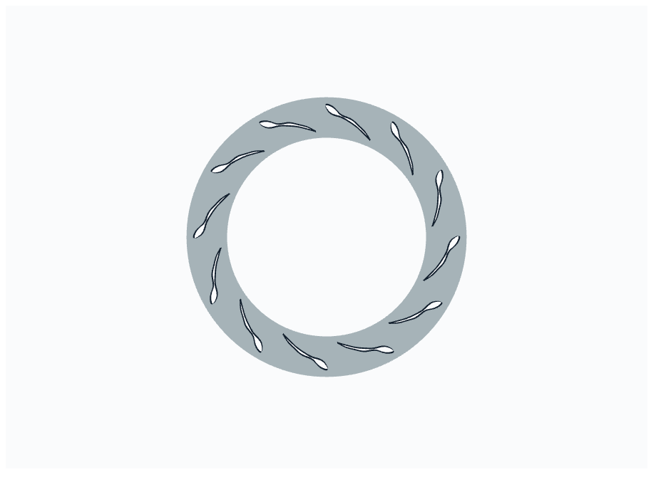
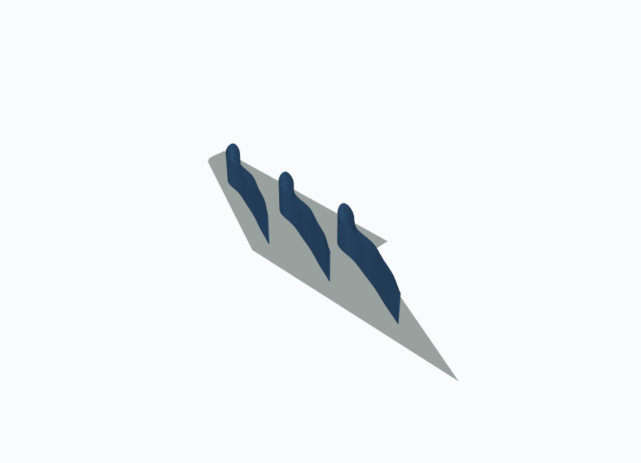
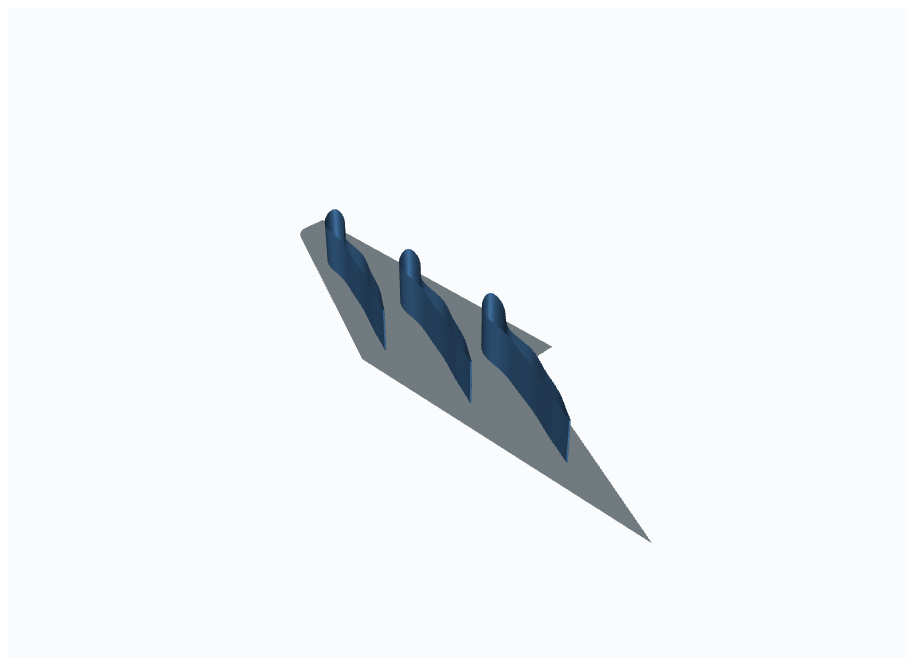

# Desktop and browser rendering comparison

Both views draw `browser_surfaces.json` with the shared style in `turbo_moc.visualization.style`: surface colours, edge colour, ambient/diffuse lighting, background, the per-family camera home view and the display-copy transform (annular rows in the (-X, -Y, Z) display frame).

## Axial stator

| Surface | Points (Gmsh / app) | Faces (Gmsh / app) | Max bounds difference [mm] |
|---|---|---|---|
| blade | 725 / 725 | 580 / 580 | 1.42e-14 |
| hub | 9977 / 9977 | 10529 / 10529 | 3.55e-15 |
| inlet | 275 / 275 | 216 / 216 | 3.20e-14 |
| outlet | 275 / 275 | 216 / 216 | 1.42e-14 |
| periodic_left | 305 / 305 | 240 / 240 | 2.84e-14 |
| periodic_right | 305 / 305 | 240 / 240 | 2.84e-14 |

Same object: **yes**. Quality inspection: 206 cells, colours stored per cell (3 x uint8), identical in both renderers.

| Desktop (PyVista) | Browser (dash-vtk) |
|---|---|
|  |  |

## Radial stator

| Surface | Points (Gmsh / app) | Faces (Gmsh / app) | Max bounds difference [mm] |
|---|---|---|---|
| blade | 715 / 715 | 572 / 572 | 1.42e-14 |
| hub | 9725 / 9725 | 10249 / 10249 | 4.26e-14 |
| inlet | 255 / 255 | 200 / 200 | 4.26e-14 |
| outlet | 255 / 255 | 200 / 200 | 0.00e+00 |
| periodic_left | 365 / 365 | 288 / 288 | 3.55e-15 |
| periodic_right | 365 / 365 | 288 / 288 | 3.55e-15 |

Same object: **yes**. Quality inspection: 214 cells, colours stored per cell (3 x uint8), identical in both renderers.

| Desktop (PyVista) | Browser (dash-vtk) |
|---|---|
|  |  |

## Linear stator

| Surface | Points (Gmsh / app) | Faces (Gmsh / app) | Max bounds difference [mm] |
|---|---|---|---|
| blade | 725 / 725 | 580 / 580 | 3.55e-15 |
| hub | 8840 / 8840 | 9292 / 9292 | 3.55e-15 |
| inlet | 165 / 165 | 128 / 128 | 0.00e+00 |
| outlet | 175 / 175 | 136 / 136 | 3.55e-15 |
| periodic_left | 675 / 675 | 536 / 536 | 3.55e-15 |
| periodic_right | 675 / 675 | 536 / 536 | 3.55e-15 |

Same object: **yes**. Quality inspection: 204 cells, colours stored per cell (3 x uint8), identical in both renderers.

| Desktop (PyVista) | Browser (dash-vtk) |
|---|---|
|  |  |

## Differences that remain

- Lighting model: VTK desktop OpenGL and vtk.js WebGL shade the same ambient/diffuse values slightly differently; colours match, shading intensity can differ.
- Mesh edges: the app draws antialiased edges in its surface shader at a set pixel width; PyVista uses native line rendering.
- Layout: the desktop view has two panels (one passage, full row), a legend, axes and bounds for static images; the app has one interactive scene with a displayed-blade count and colour pickers.
- Interaction: quality inspection controls, row visibility and camera persistence are app-only; the desktop viewer accepts the same inspection request as a keyword argument.
