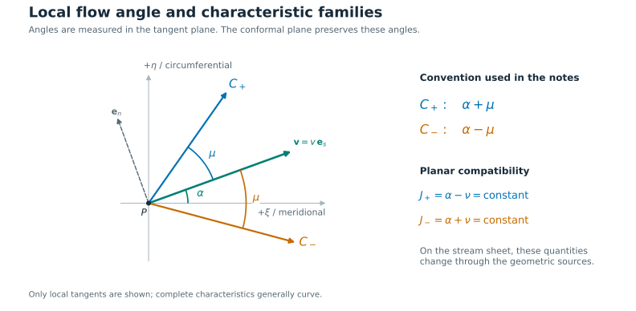
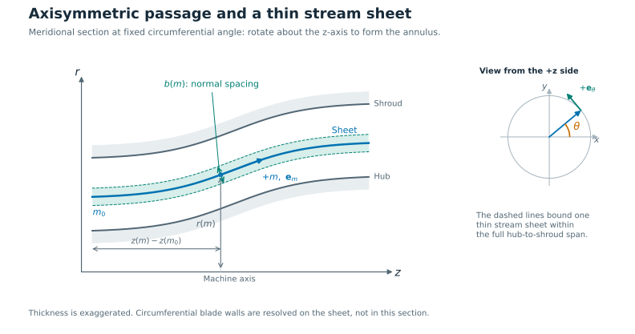
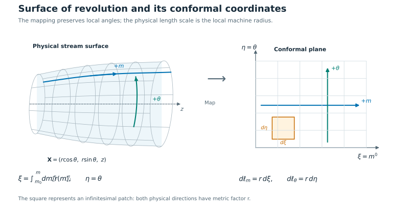
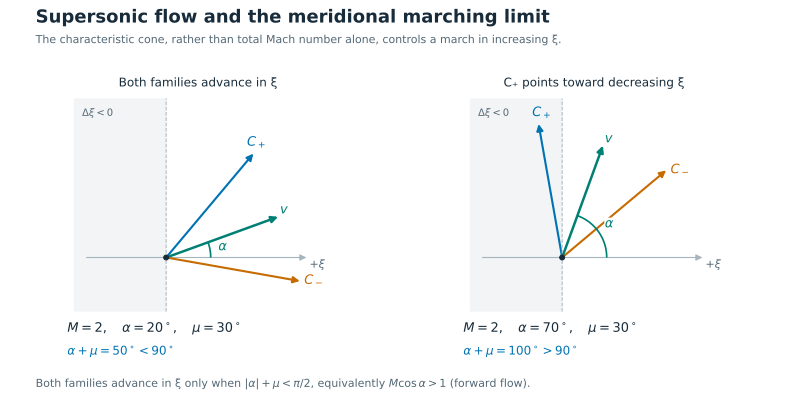

# Method of characteristics for supersonic stator design: Cartesian and conformal stream-surface formulations

## 1. Purpose and scope

These notes derive a method of characteristics (MoC) for a stationary blade row on a prescribed axisymmetric stream surface. They begin with conventional planar MoC, derive the corresponding equations in the conformal coordinates $(m', \theta)$, and give a numerical implementation procedure.

The central result is that the characteristic directions remain $\alpha\pm\mu$, while the planar invariants acquire source terms associated with radius and stream-sheet thickness. Merely mapping a planar characteristic net onto a blade-to-blade surface does not generally produce a solution of the new physical problem.

The equations below are derived explicitly for the stated reduced model. They are not presented as a transcription of the complete three-dimensional theory or of the rotor formulation in reference [3]. The broader stream-surface framework is developed in [2]; reference [3] establishes precedent for quasi-3D characteristic methods with variable radius and stream-tube thickness.

### 1.1 Assumptions

The baseline model assumes:

1. Steady, inviscid flow in a stationary frame.
2. A smooth, shock-free domain with uniform entropy $s_0$ and uniform stagnation enthalpy $h_0$ on the sheet.
3. A thermodynamically consistent equation of state, with positive density and equilibrium sound speed.
4. For the stream-surface formulation, velocity tangent to a prescribed axisymmetric surface of revolution.
5. A thin stream sheet, with prescribed thickness $b$, measured normal to that surface, and negligible variation of the state through its thickness at leading order. Its thickness is small compared with the local surface-curvature radii and normal state-variation scales.
6. Supersonic speed on the domain being marched.

Uniform entropy is stronger than entropy conservation along each streamline. The latter alone does not justify the two-variable irrotational formulation used here. Uniform $h_0$ and $s_0$ make the tangential velocity one-form locally potential. Normal momentum balance and spanwise consistency remain separate requirements.

The model can represent finite blade thickness, passage turning, and compressibility within a prescribed thin sheet. It does not determine the sheet's shape from three-dimensional equilibrium, represent secondary flow, or incorporate entropy production at shocks. A rotor requires a separate derivation with rotation and rothalpy; substituting relative velocity into these stator equations is insufficient.

### 1.2 Notation

| Symbol | Meaning |
| --- | --- |
| $v$ | Physical speed, not a coordinate-scaled speed |
| $\alpha$ | Flow angle from the positive local meridional direction |
| $a$ | Isentropic sound speed |
| $M = v/a$ | Mach number based on the physical speed |
| $\mu=\sin^{-1}(1/M)$ | Mach angle |
| $K=\sqrt{M^2-1}$ | Supersonic characteristic coefficient |
| $\nu$ | Prandtl–Meyer variable, defined along the specified isentrope |
| $m$ | Meridional arc length, increasing in the selected design direction |
| $\xi = m'$ | Dimensionless conformal meridional coordinate |
| $\eta = \theta$ | Unwrapped circumferential angle, in radians |
| $r(\xi)$ | Machine radius, strictly positive |
| $b(\xi)$ | Physical stream-sheet thickness, strictly positive |
| $\lambda$ | Euclidean arc length in the dimensionless $(\xi, \eta)$ plane |

The signs of characteristic families differ between references. Here $C_\sigma$, with $\sigma = +1$ or $-1$, is defined by its direction $\alpha + \sigma\mu$. With this convention its planar invariant is $\alpha - \sigma\nu$.

## 2. Thermodynamic reduction common to both methods

On a fixed isentrope with common stagnation enthalpy,

$$
h(v)=h_0-\frac{v^2}{2},\qquad s(v)=s_0.
\tag{1}
$$

The equation of state then supplies $\rho(v)$, $p(v)$, and $a(v)$. From $dh=dp/\rho$ at fixed entropy and $dp=a^2\,d\rho$,

$$
\frac{d\rho}{\rho}=-\frac{v\,dv}{a^2}
=-M^2\frac{dv}{v}.
\tag{2}
$$

Define the generalized Prandtl–Meyer variable along the selected supersonic branch by

$$
\nu(v;h_0,s_0)
=\int_{v_*}^{v}\sqrt{M(\bar v)^2-1}\,\frac{d\bar v}{\bar v},
\qquad d\nu=K\frac{dv}{v},
\tag{3}
$$

where $v_*$ is a chosen sonic reference state on that branch. This definition does not require constant heat capacities. On a connected supersonic branch it is increasing with $v$, although $M(v)$ itself need not be monotonic for a general equation of state.

For a calorically perfect gas, (3) gives

$$
\nu(M)=
\sqrt{\frac{\gamma+1}{\gamma-1}}
\tan^{-1}\!\sqrt{\frac{\gamma-1}{\gamma+1}(M^2-1)}
-\tan^{-1}\!\sqrt{M^2-1}.
\tag{4}
$$

All angles, including $\nu$, must be in radians. For nonideal fluids, tabulating the functions of $v$ on the chosen isentrope is usually more robust than repeatedly inverting $M$.

An equilibrium homogeneous two-phase model may use this reduction only when it has a suitable single acoustic mode and consistent equilibrium thermodynamics. A two-fluid model with phase slip and independent phase states requires its own characteristic structure.

## 3. Conventional Cartesian MoC

### 3.1 Governing equations

Let $u=v_x$ and $v_y$ denote the Cartesian velocity components, and let $v=\sqrt{u^2+v_y^2}$ denote the physical speed:

$$
u=v\cos\alpha,\qquad v_y=v\sin\alpha.
$$

For a planar passage of constant out-of-plane depth,

$$
\partial_x(\rho u)+\partial_y(\rho v_y)=0,
\qquad
\partial_x v_y-\partial_yu=0.
\tag{5}
$$

The second relation is irrotationality. Together with (1), it represents the smooth, homentropic potential-flow reduction of steady Euler flow.

Define directional derivatives in the Cartesian plane:

$$
D_s=\cos\alpha\,\partial_x+\sin\alpha\,\partial_y,
\qquad
D_n=-\sin\alpha\,\partial_x+\cos\alpha\,\partial_y.
\tag{6}
$$

With $f=\ln(v/v_{\rm ref})$, substitution into (5) yields

$$
D_n\alpha-K^2D_sf=0,
\qquad
D_s\alpha-D_nf=0.
\tag{7}
$$

### 3.2 Characteristic directions and compatibility



*Figure 1. The flow angle $\alpha$ is measured from the positive meridional direction; the Mach angle $\mu$ separates the velocity from each characteristic tangent. In the Cartesian formulation, replace $\xi,\eta$ by $x,y$. This is a local tangent sketch, not a complete characteristic net.*

Define the unit characteristic tangent and corresponding derivative:

$$
\mathbf t_\sigma=
\begin{bmatrix}
\cos(\alpha+\sigma\mu)\\
\sin(\alpha+\sigma\mu)
\end{bmatrix},
\qquad
D_\sigma=\cos\mu\,D_s+\sigma\sin\mu\,D_n.
\tag{8}
$$

Using $\cos\mu=K/M$, $\sin\mu=1/M$, and (3), the two relations in (7) give

$$
\boxed{
\frac{dy}{dx}=\tan(\alpha+\sigma\mu),
\qquad
D_\sigma(\alpha-\sigma\nu)=0.
}
\tag{9}
$$

Thus

$$
C_+:\ \alpha-\nu=J_+=\text{constant},
\qquad
C_-:\ \alpha+\nu=J_-=\text{constant}.
\tag{10}
$$

These are the conventional planar compatibility relations [1]. Curves are generally curved because their directions depend on the evolving state; straight segments are numerical approximations.

### 3.3 Interior-point process

Suppose $C_+$ from a known point $A$ intersects $C_-$ from a known point $B$ at a new point $P$. The state is obtained from

$$
\alpha_P=\frac{J_+(A)+J_-(B)}{2},
\qquad
\nu_P=\frac{J_-(B)-J_+(A)}{2}.
\tag{11}
$$

Invert (3), or (4) for a perfect gas, to obtain $v_P$ and $M_P$. Locate $P$ by intersecting characteristic segments with directions evaluated from the endpoint states. A predictor uses the upstream directions; a corrector uses endpoint-averaged unit tangents and iterates the position. Equation (11) is exact within this smooth planar model; the position calculation introduces numerical error.

### 3.4 Wall process and inverse wall construction

For a prescribed impermeable wall $y = y_w(x)$, the slip boundary condition is

$$
\alpha_w=\tan^{-1}\!\left(\frac{dy_w}{dx}\right)
\tag{12}
$$

with the appropriate continuous angle branch. Combine this condition with the incoming characteristic relation to calculate the wall state.

For inverse design, the wall is an unknown streamline:

$$
\frac{dy_w}{dx}=\tan\alpha_w.
\tag{13}
$$

A wall-state distribution or suitable characteristic construction supplies $\alpha_w$; integrating the streamline equation gives the wall. A complete blade requires pressure and suction walls whose passage belongs to the intended periodic cascade. A nozzle contour alone does not define the whole blade row.

## 4. Geometry of the conformal stream-surface coordinates

A meridional section is a plane through the machine axis. A curve $(r(m),z(m))$ in that section generates the prescribed stream surface when rotated about the axis. The blade-to-blade flow is solved on this surface; it can vary with $\theta$ even though the surface geometry is axisymmetric.



*Figure 2. The machine radius $r$ is measured from the $z$-axis, while $m$ follows the selected meridional curve. The thickness $b$ is the normal separation of the sheet's bounding stream surfaces within the full hub-to-shroud span. The inset defines increasing $\theta$ and the corresponding circumferential basis direction.*

Let a surface of revolution be parameterized by

$$
\mathbf X(m,\theta)=
\begin{bmatrix}
r(m)\cos\theta\\
r(m)\sin\theta\\
z(m)
\end{bmatrix},
\qquad
\left(\frac{dr}{dm}\right)^2+
\left(\frac{dz}{dm}\right)^2=1.
\tag{14}
$$

Define

$$
\xi=m'=\int_{m_0}^{m}\frac{d\bar m}{r(\bar m)},
\qquad \eta=\theta.
\tag{15}
$$

The surface metric becomes

$$
\boxed{d\ell^2=dm^2+r^2d\theta^2
=r^2(d\xi^2+d\eta^2).}
\tag{16}
$$

Both coordinate directions therefore have the same metric factor $r$. For any tangent curve,

$$
\tan\alpha=r\frac{d\theta}{dm}
=\frac{d\eta}{d\xi}.
\tag{17}
$$

Local angles are represented exactly in the conformal plane. Physical lengths are not: $d\ell=r\,d\lambda$.



*Figure 3. A fixed-$\theta$ meridional curve becomes a horizontal line; a fixed-$m$ circumferential circle becomes a vertical line in the unwrapped plane. The infinitesimal patch has physical side lengths $r\,d\xi$ and $r\,d\eta$. The physical surface is shown in an oblique projection; measure angles in its tangent plane, not from the projected drawing.*

The plotted ordinate $r(m)\theta$ is not generally an equivalent conformal coordinate, since $d(r\theta)=r\,d\theta+\theta\,dr$. A constant reference radius times $\theta$ can be used for display, provided the corresponding metric is retained.

## 5. Governing equations on a thin stream sheet

### 5.1 Continuity

Set

$$
V_m=v\cos\alpha,\qquad V_\theta=v\sin\alpha.
$$

Thin-sheet mass conservation is

$$
\partial_m(rb\rho V_m)+\partial_\theta(b\rho V_\theta)=0.
\tag{18}
$$

As $\partial_m=r^{-1}\partial_\xi$ and $r$ has no circumferential dependence,

$$
\boxed{
\partial_\xi(rb\rho v\cos\alpha)
+\partial_\eta(rb\rho v\sin\alpha)=0.
}
\tag{19}
$$

Here $b$ represents the spacing of bounding stream surfaces, not circumferential passage width. The latter is resolved by the two-dimensional sheet solution itself.

### 5.2 Tangential momentum and potential relation

For the prescribed axisymmetric sheet, the tangential Euler equations are

$$
\begin{gather}
V_m\partial_mV_m+
\frac{V_\theta}{r}\partial_\theta V_m
-\frac{r_m}{r}V_\theta^2
=-\frac{1}{\rho}\partial_m p,
\tag{20a}\\
V_m\partial_mV_\theta+
\frac{V_\theta}{r}\partial_\theta V_\theta
+\frac{r_m}{r}V_mV_\theta
=-\frac{1}{\rho r}\partial_\theta p,
\tag{20b}
\end{gather}
$$

Here $r_m=dr/dm$.

Under the common $h_0,s_0$ assumptions, their tangential potential reduction is

$$
\partial_m(rV_\theta)-\partial_\theta V_m=0,
$$

or

$$
\boxed{
\partial_\xi(rq\sin\alpha)
-\partial_\eta(rq\cos\alpha)=0.
}
\tag{21}
$$

Equivalently, locally there is a potential $\Phi$ such that

$$
\Phi_\xi=rV_m,\qquad \Phi_\eta=rV_\theta.
\tag{22}
$$

The potential need only exist locally. Swirl can produce nonzero circulation around the machine axis, so a globally single-valued potential on the complete annulus is not assumed. An unwrapped $\eta$ coordinate accommodates this distinction.

The potential equation is consequently

$$
\partial_\xi(b\rho\Phi_\xi)+
\partial_\eta(b\rho\Phi_\eta)=0,
\qquad
v=\frac{\sqrt{\Phi_\xi^2+\Phi_\eta^2}}{r}.
\tag{23}
$$

Equation (23) provides a useful independent check: using scaled velocities $r V_m, r V_\theta$ makes the potential relation look Cartesian, but the physical speed entering thermodynamics still contains $1/r$. Scaling the velocity does not remove the geometric physics.

Only tangential momentum is represented here. Pressure gradients normal to the stream surface must support meridional curvature and the normal component of circumferential acceleration. A prescribed sheet need not satisfy that separate balance in an actual three-dimensional flow.

### 5.3 Primitive equations

In the conformal plane define

$$
D_s=\cos\alpha\,\partial_\xi+\sin\alpha\,\partial_\eta,
\qquad
D_n=-\sin\alpha\,\partial_\xi+\cos\alpha\,\partial_\eta.
\tag{24}
$$

These are unit directional derivatives in the computational plane; physical surface derivatives are $D_s/r$ and $D_n/r$.

Define dimensionless logarithms

$$
g=\ln(r/r_{\rm ref}),\qquad
H=\ln\!\left(\frac{rb}{r_{\rm ref}b_{\rm ref}}\right),
\qquad f=\ln(v/v_{\rm ref}).
$$

Expanding (19) and (21), then using (2), gives

$$
\boxed{
\begin{gathered}
D_n\alpha-K^2D_sf=-D_sH,\\
D_s\alpha-D_nf=D_ng.
\end{gathered}
}
\tag{25}
$$

The first geometric term comes from conservation of mass through a sheet of changing metric and thickness. The second comes from the variation of the physical basis and radius in tangential momentum.

## 6. Characteristic equations in $(m', \theta)$

### 6.1 Directions

The geometry enters (25) through terms without derivatives of the unknown state. The principal part is the same as in (7), so

$$
\boxed{
\frac{d\eta}{d\xi}=\tan(\alpha+\sigma\mu).
}
\tag{26}
$$

For numerics, the vector form avoids infinite slopes:

$$
\boxed{
\frac{d\mathbf x_c}{d\lambda}=\mathbf t_\sigma,
\qquad
\mathbf x_c=(\xi,\eta)^T.
}
\tag{27}
$$

### 6.2 Compatibility with geometric source terms

Using $D_\sigma=\cos\mu\,D_s+\sigma\sin\mu\,D_n$, (25) gives

$$
\boxed{
\begin{gathered}
\frac{d}{d\lambda}(\alpha-\sigma\nu)
=\mathcal R_\sigma,\\
\mathcal R_\sigma=
\cos\mu\,D_ng-\sigma\sin\mu\,D_sH.
\end{gathered}
}
\tag{28}
$$

For example,

$$
D_+(\alpha-\nu)
=\cos\mu(D_s\alpha-KD_sf)
+\sin\mu(D_n\alpha-KD_nf).
$$

Substituting (25) cancels the unknown derivatives because $\cos\mu=K\sin\mu$, leaving $\cos\mu\,D_ng-\sin\mu\,D_sH$. The other sign follows identically. This establishes the sign convention in (28).

For the intended axisymmetric geometry $r = r(\xi)$ and $b = b(\xi)$, define

$$
G_r=\frac{d\ln r}{d\xi}=\frac{dr}{dm},
\qquad
G_b=\frac{d\ln b}{d\xi}=\frac{r}{b}\frac{db}{dm},
\qquad
G_A=G_r+G_b.
\tag{29}
$$

Then

$$
\boxed{
\mathcal R_\sigma
=-\cos\mu\sin\alpha\,G_r
-\sigma\sin\mu\cos\alpha\,G_A.
}
\tag{30}
$$

Equations (27), (28), and (30), together with the thermodynamic table, are the main equations to implement.

Where $\xi$ can safely serve as the independent variable,

$$
\frac{d(\alpha-\sigma\nu)}{d\xi}
=\frac{\mathcal R_\sigma}{\cos(\alpha+\sigma\mu)}.
\tag{31}
$$

If integration uses physical arc length $\ell$ instead, the right-hand side of (28) must be divided by $r$. Mixing the two arc-length conventions introduces a dimensional and numerical error.

## 7. Numerical implementation

### 7.1 Geometry and thermodynamics interfaces

Preprocess smooth geometry functions

```text
geometry(xi) -> r, z, b, G_r, G_b
thermodynamics(v) -> rho, p, a, M, mu, nu
inverse_nu(nu) -> v
```

Construct $\xi(m)$ by quadrature, invert it on its monotonic domain, and evaluate $r,z,b$ and their derivatives consistently. Smooth interpolation is preferable because noisy geometry derivatives directly contaminate the characteristic sources. Keep thickness positive and use the selected orientation of $m$ consistently. For radial inflow with $m$ increasing inward, $G_r = -1$ on a planar radial sheet; for radial outflow it is $+1$.

Store at each node the computational position, $v,\alpha$, thermodynamic properties, and geometry. Recover Cartesian coordinates only through (14), after evaluating the solution or wall in the conformal plane.

### 7.2 Initial data

Prescribe $v$ and $\alpha$ on a non-characteristic initial curve in a wholly supersonic region. Their values must be consistent with the specified $h_0,s_0$ and the passage boundary conditions. The curve must support the intended downstream characteristic construction; arbitrary initial values need not satisfy all global design constraints.

At $M = 1$, the two characteristic lines coalesce and the usual interior-point process degenerates. Initialize just downstream using a transonic/throat solution, or implement a dedicated sonic-point construction. A sharp-corner centered fan is appropriate only where its local geometric and boundary assumptions hold.

### 7.3 Interior-point process: six-equation vector formulation

Let $A$ and $B$ be known points supplying incoming $C_+$ and $C_-$, respectively. Seek

$$
(\xi_P,\eta_P,v_P,\alpha_P,\Delta\lambda_+,\Delta\lambda_-).
$$

An endpoint-trapezoidal approximation gives two vector equations:

$$
\begin{gather}
\mathbf x_P-\mathbf x_A
=\frac{\Delta\lambda_+}{2}
[\mathbf t_+(A)+\mathbf t_+(P)],
\tag{32a}\\
\mathbf x_P-\mathbf x_B
=\frac{\Delta\lambda_-}{2}
[\mathbf t_-(B)+\mathbf t_-(P)],
\tag{32b}
\end{gather}
$$

and two scalar compatibility equations:

$$
\begin{gather}
J_+(P)-J_+(A)
=\frac{\Delta\lambda_+}{2}
[\mathcal R_+(A)+\mathcal R_+(P)],
\tag{33a}\\
J_-(P)-J_-(B)
=\frac{\Delta\lambda_-}{2}
[\mathcal R_-(B)+\mathcal R_-(P)],
\tag{33b}
\end{gather}
$$

where $J_\sigma=\alpha-\sigma\nu(v)$. Equations (32) supply four scalar residuals and (33) supplies two. Solve the resulting nonlinear system with Newton or a safeguarded nonlinear solver. Automatic differentiation is useful because geometry, thermodynamics, and the unknown intersection position all enter the same residual.

A practical predictor is:

1. Intersect rays from $A$ and $B$ using their upstream characteristic directions.
2. Estimate path increments from that intersection.
3. Predict the transported invariants as $J_\sigma(P)=J_\sigma(\mathrm{upstream})+\Delta\lambda_\sigma\mathcal R_\sigma(\mathrm{upstream})$.
4. Use their sum and difference to estimate $\alpha_P$ and $\nu_P$.
5. Invert $\nu$, then solve (32)–(33) jointly.

Accept only solutions on the intended supersonic thermodynamic branch, with positive path increments and consistent characteristic connectivity. Reduce spacing when the predictor is poor or geometric/state changes over a segment are large. In a smooth, well-conditioned net, trapezoidal integration has third-order local integration error and supports second-order accumulated accuracy; demonstrate the observed order by refinement rather than assuming it for every boundary construction.

### 7.4 Wall-point process

For a prescribed wall $\eta = \eta_w(\xi)$, impose

$$
\eta_P=\eta_w(\xi_P),
\qquad
\alpha_P=\operatorname{atan2}(\eta_w'(\xi_P),1),
\tag{34}
$$

on the continuous forward-facing branch. Combine these two boundary relations with one incoming characteristic's two position residuals and one compatibility residual. This gives five equations for $\xi_P,\eta_P,v_P,\alpha_P,\Delta\lambda$.

For inverse wall construction, the streamline relation remains

$$
\frac{d\eta_w}{d\xi}=\tan\alpha_w.
\tag{35}
$$

The difference is that the wall state must now be obtained with sourced compatibility. If a wall Mach or pressure distribution is prescribed, it fixes $v_w$; the incoming characteristic determines $\alpha_w$, and the streamline relation determines wall position. Numerical integration can use the same endpoint-averaged vector approach with the streamline tangent $(\cos\alpha,\sin\alpha)$.

### 7.5 Periodicity and blade count

For $N$ identical blades,

$$
\eta\mapsto\eta+\frac{2\pi}{N}
\tag{36}
$$

defines a neighbouring passage. This is a translation in the conformal plane and a rotation in physical space. Keep $\eta$ unwrapped during numerical construction; apply angle wrapping only for presentation or export.

Do not treat the pressure and suction walls as interchangeable periodic flow boundaries: they are impermeable walls belonging to neighbouring blades. Periodicity applies to the complete repeated passage and any corresponding open boundaries used in its analysis.

### 7.6 Inverse design and target matching

Use the MoC as the local flow/wall solver inside an outer design iteration when necessary. Typical residuals include mass-flow capacity, exit Mach distribution, exit angle distribution, and geometric fit. Typical adjustable quantities include the initial expansion, wall-state distribution, passage scale, and selected meridional or thickness parameters.

Prescribing an arbitrary initial state, meridional geometry, blade count, mass flow, and complete outlet state can overconstrain the design. Specify which quantities are fixed and leave enough design freedom to satisfy the remaining targets.

Classical planar minimum-length constructions rely on invariant transport and special symmetry. A finite-domain uniform exit target on a varying-radius sheet requires the sourced equations; the familiar perfect-gas planar relation $\alpha_{w,\max}=\nu_{\rm exit}/2$ cannot simply be reused as a global design rule.

## 8. A limitation of marching monotonically in $m'$

For forward meridional flow on the branch $\lvert\alpha\rvert<\pi/2$, both characteristic directions have positive meridional components only if

$$
\cos(\alpha+\mu)>0,
\qquad
\cos(\alpha-\mu)>0.
$$

Equivalently,

$$
\boxed{|\alpha|+\mu<\frac{\pi}{2}
\quad\Longleftrightarrow\quad
M\cos\alpha>1.}
\tag{37}
$$

Since $M\cos\alpha=V_m/a$, this condition requires the meridional velocity component itself to be supersonic.

Thus total supersonic speed does not guarantee that a strictly downstream $\xi$ march is possible. For example, $M = 2$ and $\alpha=70^\circ$ give $\mu=30^\circ$; one characteristic points toward decreasing $\xi$.



*Figure 4. Both examples have $M=2$ and $\mu=30^\circ$. At $\alpha=70^\circ$, the $C_+$ tangent has angle $100^\circ$ from $+\xi$, so its meridional component is negative despite the supersonic physical speed.*

This is a marching-direction limitation, not a loss of hyperbolicity: the reduced equations remain hyperbolic for $M > 1$. The vector residual avoids tangent singularities but does not fix an inappropriate marching topology. Use an initial curve and construction aligned with the local downstream characteristic cone, change computational marching direction, or use a more general characteristic net/flow solver.

## 9. Physical area, mass flow, and the sonic throat

For a cross-sheet cut $\Gamma$, the leading-order physical area is

$$
A_\Gamma=\int_\Gamma b r\,d\lambda.
\tag{38}
$$

This is a geometric area; it equals the flow-normal area only when the cut is normal to the velocity. For a cut parameterized in the conformal plane and oriented so that its normal is $(d\eta,-d\xi)$, mass flow is

$$
\boxed{
\dot m_\Gamma=
\int_\Gamma br\rho
(V_m\,d\eta-V_\theta\,d\xi).
}
\tag{39}
$$

At a constant-$\xi$ station this reduces to

$$
\dot m=\int_{\eta_{\rm lower}}^{\eta_{\rm upper}}
br\rho v\cos\alpha\,d\eta.
\tag{40}
$$

The minimum geometric gap, minimum physical area, minimum area normal to the actual flow, and sonic surface should be distinguished. They need not coincide in a turning nonuniform passage. Calculate the state and flux, rather than identifying choking from a conformal-plane gap alone.

For a mapped planar cut of small extent, the physical area approximately scales with $br$. This can guide initial sizing, but an area–Mach relation is a quasi-one-dimensional approximation and cannot enforce the full two-dimensional outlet state or cancel waves.

## 10. Differences between the two methods

| Aspect | Conventional planar MoC | Stream-sheet MoC in $(m', \theta)$ |
| --- | --- | --- |
| Physical domain | Planar passage with constant depth | Prescribed surface of revolution with thin-sheet thickness |
| Local characteristic direction | $\alpha\pm\mu$ | Same expression in the conformal plane |
| Compatibility | $d(\alpha-\sigma\nu)=0$ | $d(\alpha-\sigma\nu)=\mathcal R_\sigma\,d\lambda$ |
| State at an interior intersection | Obtained directly from two invariants | Coupled to position through source integration |
| Geometry input | Wall/cascade geometry | Wall/cascade geometry plus $r,z,b$ and their derivatives |
| Periodicity | Usually Cartesian pitch translation | Angular translation $2\pi/N$, equivalent to physical rotation |
| Length scale | Cartesian coordinates are physical lengths | Physical local length equals $r$ times computational length |
| Thermodynamics | Based on physical speed | Also based on physical speed, not $r v$ |
| Throat sizing | Planar opening times depth, subject to flow-normality | Physical cut integration with metric and thickness |
| Exit targets | Enforced within the planar model | Enforced within the prescribed-sheet model |
| Normal/spanwise equilibrium | Outside the planar model | Still outside the prescribed-sheet model |
| Computational work | Cheap invariant algebra and geometry iteration | Nonlinear point solves and source evaluations |

The stream-sheet method remains a two-dimensional characteristic calculation, so its additional cost should normally be modest compared with full 3D CFD. Its accuracy gain depends on how well the prescribed sheets and thicknesses represent the actual flow.

## 11. Limiting cases and what they establish

### 11.1 Constant radius and constant thickness

When $G_r = G_b = 0$, both sources vanish exactly. A cylinder can be unrolled using $x = r_0 \xi$, $y = r_0 \eta$; the equations recover planar MoC. This is an exact limit of the reduced model, not a guarantee that a finite-span annular blade row has no spanwise effects.

### 11.2 Constant radius with changing thickness

With $G_r = 0$,

$$
\mathcal R_\sigma=-\sigma\sin\mu\cos\alpha\,G_b.
$$

The sheet has a depth-variation correction even though its radius is constant.

### 11.3 Changing radius with $br=\mathrm{constant}$

Here $G_A = 0$, but

$$
\mathcal R_\sigma=-\cos\mu\sin\alpha\,G_r.
$$

For turning flow this generally remains nonzero. Compensating passage-area scaling by changing thickness does not restore planar invariants. For the special meridional state $\alpha = 0$, the remaining term vanishes.

### 11.4 A flat radial sheet with constant height

For $z=\mathrm{constant}$, $m = r$, and $b=\mathrm{constant}$,

$$
\xi=\ln(r/r_{\rm ref}),\qquad G_r=G_A=1.
$$

This physical surface is a plane. Its sourced conformal equations are exactly the logarithmic-polar reparameterization of ordinary planar potential flow. Therefore, MoC solved directly in physical Cartesian coordinates on the same radial passage and MoC solved in logarithmic-polar coordinates should converge to the same solution.

This does not imply that a linearly periodic nozzle solution survives an exponential geometry mapping. Solving the same physical domain in two coordinate systems and mapping a solution to a different domain are different operations. A radial blade row uses rotationally related neighbouring blades.

### 11.5 Small geometric changes

The cumulative correction to an invariant is

$$
\Delta J_\sigma=\int_{C_\sigma}\mathcal R_\sigma\,d\lambda.
\tag{41}
$$

This integral, rather than only the net change in radius, measures the direct discrepancy from the planar compatibility relation along a particular characteristic. Short passages with small radius and thickness changes may be well approximated by mapped planar sections. Large turning, strong sheet convergence, or wave-cancellation requirements can make even modest geometric differences consequential.

### 11.6 Relation to the axisymmetric nozzle MoC

The classical axisymmetric nozzle MoC [5] belongs to the same family. A planar characteristic structure carries a geometric weight in continuity. For an axisymmetric nozzle in its meridional plane $(x,y)$, with $y$ the distance from the axis,

$$
\partial_x(y\rho u)+\partial_y(y\rho v_y)=0,
\qquad
\partial_xv_y-\partial_yu=0.
\tag{43a}
$$

The plane is flat, so the metric is Cartesian ($g=0$), and the continuity weight is $y$. Equation (25) applies with $H=\ln y$. Since $D_sH=\sin\alpha/y$, (28) gives

$$
\frac{d(\alpha-\sigma\nu)}{d\lambda}=-\sigma\frac{\sin\mu\sin\alpha}{y}.
\tag{43b}
$$

With $dy=\sin(\alpha+\sigma\mu)\,d\lambda$, this becomes the familiar form, e.g. along $C_-$:

$$
d(\alpha+\nu)=\frac{1}{\sqrt{M^2-1}-\cot\alpha}\,\frac{dy}{y}.
$$

The planar case is recovered without the weight. The TurboMoC solvers already implement this axisymmetric source through the `delta_flow` switch ($\delta=0$ planar, $\delta=1$ axisymmetric).

The two models compare as follows:

| | Axisymmetric nozzle | Stream-sheet blade row |
| --- | --- | --- |
| Surface | Flat meridional plane ($S_2$-type) | Curved blade-to-blade surface of revolution ($S_1$-type) |
| Continuity weight | $y$, varying **across** the passage | $rb$, varying **along** the meridional coordinate |
| Metric | Cartesian: no $G_r$ term | Conformal factor $r$: additional $G_r\sin\alpha$ term (angular momentum) |
| Planar limit | $y\to\infty$ (thin annulus far from the axis) | $G_r=G_b=0$ (cylinder of constant thickness) |

The stream-sheet formulation is therefore not a planar model with ad hoc corrections. It follows from the same governing equations as the planar and axisymmetric methods, on a different surface and with a different weight and metric. All three share the characteristic directions $\alpha\pm\mu$ and differ only in their source terms.

## 12. Placing a planar design on an axial annulus: three stacking options

### 12.1 Setting

Consider an axial row with cylindrical hub and shroud and constant blade height. Every span station is then a cylinder $r=\text{const}$ with constant sheet thickness, so $G_r=G_b=0$ and the planar MoC is exact on each sheet (§11.1). The planar design is a cascade section with chord $c_d$, pitch $s_d$, throat $o_d$ and metal angles. Its MoC solution is invariant under **uniform** scaling: a similar section with the same pitch-to-chord ratio carries the same Mach field. It is not invariant under a pitch change at fixed chord, or under stretching in one direction only.

With $N$ blades the physical pitch is $s(r)=2\pi r/N$ at every radius. The three options differ only in which section each cylinder carries:

| | A. Pitch-scaled radial stacking | B. Conformal, constant chord | C. Conformal, chord $\propto r$ |
| --- | --- | --- | --- |
| Section at radius $r$ | Hub section stretched pitchwise by $f=r/r_h$ | Similar copy, chord $c$ | Similar copy, chord $c\,r/R_{\rm ref}$ |
| Metal angles | $\tan\alpha(r)=f\tan\alpha_h$ | Exact | Exact |
| Pitch-to-chord ratio | Pitchwise ratio fixed; section distorted | $\propto r$ | Constant |
| Designed passage reproduced | At the hub only | At most one radius, if $N$ matches | At every radius, if $N$ matches |
| Blade stacking | Radial lines ($\theta$ independent of $r$) | Leading edge at $z=0$; similar sections | Same $q$-section on every sheet; trailing edge $z\propto r$ |
| Endwalls | Cylindrical | Cylindrical | Cylindrical (no flaring) |
| Implementation | Legacy app (`deprecated/geometry/annular.py`, `flare="pitch_scale"`) | New app as used by default | New app inputs; $N$ matched by hand |

### 12.2 Option A: pitch-scaled radial stacking

The section at radius $r$ keeps its axial coordinate and stretches its pitchwise coordinate:

$$
x_r=f\,x_h,\qquad z_r=z_h,\qquad \theta=-x_r/r=-x_h/r_h,\qquad f=r/r_h.
\tag{44}
$$

The angular pitch is $2\pi/N$ at every radius and the blade is radially stacked. Sizing fixes the hub pitch to the design value, so the hub section is the MoC design. Elsewhere the section is an affine, non-similar copy. Angles change, $\tan\alpha(r)=f\tan\alpha_h$, and widths across the flow scale non-uniformly because the flow turns through the passage.

At high stagger the width across the flow is roughly $s\cos\alpha$. The pitch grows and $\cos\alpha$ falls, and the two nearly cancel. For the default Cyclopentane stator ($\alpha_{\rm out}=65^\circ$), the narrowest blade-to-blade gap changes by only $+0.9\,\%$, $+1.7\,\%$ and $+3.0\,\%$ for $f=1.05$, $1.10$ and $1.20$, while the exit angle becomes $66.1^\circ$, $67.0^\circ$ and $68.8^\circ$. Option A is therefore a reasonable approximation for short blades: nearly the designed passage, at the cost of a few degrees of angle. It is exact only at the hub. The legacy sizing also takes the mass flow from the hub throat over the full height.

### 12.3 Option B: conformal similarity with constant chord

The conformal map $q=(R_{\rm ref}\theta,\,-R_{\rm ref}m')$ scales lengths by $r/R_{\rm ref}$ on each cylinder. With the axial chord $c$ held constant, the conformal chord $c/r$ varies. Every section is a similar copy of the planar blade with the same physical size, while the pitch grows as $2\pi r/N$. The angles are exact, but the pitch-to-chord ratio grows with $r$. The section reproduces the designed passage only where

$$
\frac{s(r)}{c}=\frac{s_d}{c_d}.
\tag{45}
$$

This holds at one radius at most, and only for the matching blade count. The app sets the pitch from $N$ and $R_{\rm ref}$; since the natural-count update (§12.6) it suggests $N$ from the design pitch at midspan and reports the pitch deviation.

For the default stator ($R_{\rm ref}=105$ mm, $c=20$ mm), the matching count is $N=27.4$. With the default $N=31$ the applied pitch is $0.84$, $0.88$ and $0.93$ of the designed pitch at hub, midspan and tip. The narrowest gap is $0.75$, $0.81$ and $0.88$ of the design: about $1.6$ times the pitch change. Even with a matching $N$, a span of $\pm h/(2R_{\rm ref})$ around the reference radius would change the throat by about $\pm 8\,\%$ at hub and tip for this row.

### 12.4 Option C: conformal similarity with chord proportional to radius

Choose the chord so that the conformal chord is constant:

$$
c(r)=c_{\rm ref}\,\frac{r}{R_{\rm ref}},
\qquad
\frac{c_{\rm tip}}{c_{\rm hub}}=\frac{r_{\rm tip}}{r_{\rm hub}}.
\tag{46}
$$

Then $m'$-chord and pitch are the same on every sheet. Every cylinder carries the same $q$-section, i.e. an exactly similar copy of the planar design, scaled by $r/R_{\rm ref}$. Angles, pitch-to-chord ratio, throat-to-pitch ratio and area ratio are all those of the MoC design, provided the blade count matches:

$$
N=\frac{2\pi R_{\rm ref}}{s_d\,c(R_{\rm ref})/c_d}.
\tag{47}
$$

In practice, round (47) to an integer and adjust the chord or $R_{\rm ref}$ slightly to make it exact. The throat grows in proportion to $r$, consistent with the annulus. No section scaling or core deformation is required between span stations.

No endwall flaring is needed: hub and shroud remain cylinders and the blade height is unchanged. Only the planform becomes slightly trapezoidal. The leading edge stays at $z=0$ and the trailing edge lies at $z=r\,m'_{\rm TE}$, slightly further downstream toward the tip. For the default row ($r=100$–$110$ mm) the chord grows from $20$ to $22$ mm.

The current app supports this through its `hub_chord`/`tip_chord` inputs. It suggests $N=\lceil N^*\rceil$ (§12.6); exact matching would still require rounding to the nearest count and a small chord adjustment. For the default stator with chord $20\to22$ mm:

| Blade count | Section scale (hub/mid/tip) | Pitch / design | Throat / design |
| --- | --- | --- | --- |
| $N=31$ | $1/1/1$ | $0.84$ at every radius | $0.75$ at every radius |
| $N=26$ | $1/1/1$ | $1.002$ at every radius | $1.004$ at every radius |

### 12.5 Comments

- All three options use the same planar MoC solution. They differ in how its section is stacked along the span, not in the characteristic calculation.
- Option C is the only one reproducing the designed nozzle on every sheet. It requires a tapered chord and a matched blade count.
- Option A changes the angles but nearly preserves the passage widths at high stagger. Option B preserves the angles but changes the passage away from one radius, and everywhere if $N$ is not matched.
- These statements assume cylindrical sheets. For radial or mixed-flow rows $G_r\neq0$ (§11.4), and none of the stacking options reproduces a planar solution exactly. The sourced equations of §6 are then required.
- None of the options includes spanwise equilibrium. The sheets remain prescribed (§5.2).

### 12.6 Blade count and sizing in the applications

**Legacy app (mass-flow sizing).** The inputs were $\dot m$, $N$ and $r_h$. The planar design was scaled uniformly by

$$
k=\frac{2\pi r_h/N}{s_d},
\qquad
H=\frac{\dot m}{\rho_*a_*\,k\,o_d\,N},
\tag{48}
$$

so the hub pitch equalled the scaled design pitch and the blade height $H$ followed from sonic flow through the hub throat (`size_stator_mode_a`). The hub section was therefore the MoC design, and the mass flow was a specified input. The span was then built with Option A, and the throat over the full height was taken equal to the hub throat.

**New app (geometric sizing).** The inputs are the meridional dimensions: hub radius, blade height, hub and tip chord (or inlet and outlet radii for a radial row). Mass flow is not an input. After each successful MoC or vortex solve, `apps/app/blade_counts.py` computes a natural blade count from the solver's own passage:

$$
k_d=\frac{s_d}{c_d},
\qquad
N^*=\frac{2\pi}{k_d\,C'},
\qquad
C'=\int_{\rm LE}^{\rm TE}\frac{dm}{r}\Big|_{\eta=0.5}.
\tag{49}
$$

Here $s_d$ is the native pitch and $c_d$ the native meridional chord: for the stator, the axial extent of the fitted blade contour; for the rotor, the axial extent of the vortex blade, whose pitch is the vortex method's natural spacing. For an axial row $C'=c_{\rm mid}/R_{\rm ref}$, so (49) is (47) evaluated at midspan. For a radial row with flat endwalls $C'=\lvert\ln(r_{\rm out}/r_{\rm in})\rvert$ is the same at every span. For a linear cascade the app reports the natural pitch $k_d\,c$ instead of a count.

The app then sets the row's $N=\max(2,\lceil N^*\rceil)$ and lets the user override it. It displays $N^*$, the natural pitch and the deviation of the applied pitch. A new successful solve resets the count; geometry edits update the reference without overwriting a manual count. The applied pitch is still $2\pi R_{\rm ref}/N$ (Option B), so the designed passage is reproduced exactly only if $N=N^*$ at the reference radius.

This makes the stator and the rotor each consistent with their own solver passage, which was not ensured before. The two rows may have different counts.

**Remaining deviations.** For the default Cyclopentane stator ($R_{\rm ref}=105$ mm, height $10$ mm), with pitch and throat relative to the natural values at hub, midspan and tip:

| Row | $N^*$ | $N$ | Pitch / natural | Throat / natural |
| --- | --- | --- | --- | --- |
| Stator, constant chord $20$ mm | $27.36$ | $28$ | $0.93$, $0.98$, $1.02$ | $0.88$, $0.96$, $1.04$ |
| Stator, chord $\propto r$ ($20\to22$ mm) | $26.05$ | $27$ | $0.965$ at every span | $0.94$ at every span |
| Stator, chord $\propto r$, $N=26$ | $26.05$ | $26$ | $1.002$ at every span | $1.004$ at every span |
| Rotor (vortex), constant chord | $26.94$ | $27$ | $0.998$ at midspan | — |

Two effects remain:

1. **Rounding.** Rounding $N^*$ up always gives a smaller pitch, and the throat narrows by about $1.6$ times the pitch change. The pitch error is at most $1/N$. Rounding to the nearest integer would halve the average error. Adjusting a continuous dimension instead, for example $c_{\rm mid}=2\pi R_{\rm ref}/(k_dN)$, would remove it. Neither is implemented.
2. **Span.** With a constant chord the count is exact at midspan only, and the throat varies across the span roughly as $(r/R_{\rm ref})^{1.6}$, here $-12\,\%$ to $+4\,\%$. With chord $\propto r$ (Option C), one count applies to the whole span.

**Mass flow is now an output.** The geometry and the planar solution fix the throat, so the stage capacity follows from the chosen dimensions. The app does not compute a throat-based capacity. It only estimates a mass flow for the specific-speed rotor input (`apps/app/rotor_speed.py`), from stator exit continuity over the full annulus without blade blockage: $\dot m\approx\rho_e\,M_ea_e\cos\alpha_e\,\pi(r_t^2-r_h^2)$. A throat-based estimate consistent with (48), $\dot m\approx\rho_*a_*\,N\int o(r)\,dr$, would follow directly from the mapped sections.

### 12.7 Throat half-height and shape parameters

After uniform scaling, only scale-free ratios of the planar design reach the machine: pitch-to-chord, throat-to-pitch and area ratio. The absolute throat half-height $y_t$ therefore cancels. Doubling $y_t$ at fixed shape doubles the design chord and pitch, and the scale factor $k$ (pitch-based or chord-based) halves.

In the solver, however, the kernel-arc radius $\rho_d$ (`rotation_around_center`: centre at $(0,\rho_d+y_t)$) and the Sauer throat curvature $\rho_t$ are absolute lengths, and so is the blade's trailing-edge radius $r_{\rm TE}$ (`r_trailing`). Changing $y_t$ alone therefore changes the shape through $\rho_d/y_t$, $\rho_t/y_t$ and $r_{\rm TE}/y_t$. For the nitrogen test case ($P_0=5$ bar, $T_0=300$ K, $p_{\rm back}=1$ bar, $\alpha_{\rm out}=65^\circ$), with $N^*$ for a $20$ mm chord at $R_{\rm ref}=105$ mm:

| Case | Exit $M$ | Nozzle length $/\,y_t$ | Pitch / chord | Throat / pitch | $N^*$ |
| --- | --- | --- | --- | --- | --- |
| $y_t=10$ mm; $\rho_t,\rho_d,r_{\rm TE}=0.2,\,0.1,\,0.5$ | $1.7088$ | $4.75$ | $1.134$ | $0.152$ | $29.1$ |
| $y_t=20$ mm; same absolute $\rho_t,\rho_d,r_{\rm TE}$ | $1.7087$ | $4.07$ | $1.214$ | $0.155$ | $27.2$ |
| $y_t=20$ mm; $\rho_t,\rho_d,r_{\rm TE}$ doubled | $1.7088$ | $4.75$ | $1.134$ | $0.152$ | $29.1$ |

The exit Mach number is unchanged in all three cases, since the area ratio is set by the back pressure. The third case is a pure scaling and gives the same machine as the first. The relevant design parameters are $\rho_d/y_t$ (kernel curvature, hence nozzle length and chord), $\rho_t/y_t$ and $r_{\rm TE}/y_t$ (exit blockage in the pitch relation), together with the exit Mach number, the metal angles and `inlet_opening_ratio`.

Expressing these inputs relative to $y_t$ is tracked as F04 in `docs/internal_information/app_development_checklist.md`.

## 13. Verification before using the method for blade design

1. **Planar recovery:** Set $r,b$ constant and recover the existing planar characteristic states and wall geometry after uniform dimensional scaling.
2. **Radial meridional flow:** For $\alpha = 0$, no circumferential dependence, and constant $b$, verify $r\rho v=\mathrm{constant}$ and

   $$
   (M^2-1)\frac{d\ln v}{d\ln r}=1.
   \tag{42}
   $$

3. **Radial flow with swirl:** Verify the exact axisymmetric relations

   $$
   rb\rho v\cos\alpha=F,
   \qquad rq\sin\alpha=L,
   \qquad h+v^2/2=h_0.
   \tag{43}
   $$

   Here $F$ is mass flow per radian and $L$ is angular momentum. This benchmark tests both geometric terms and their signs.
4. **Coordinate equivalence:** On a flat, constant-height radial passage, compare independent Cartesian and conformal calculations of the same physical problem.
5. **Flux conservation:** Evaluate (39) across several complete cuts and check convergence of the flux mismatch with refinement.
6. **Mesh refinement:** Assess exit-state distributions and wall locations, not only nonlinear solver residuals.
7. **3D assessment:** Compare with an inviscid 3D calculation to isolate sheet-model errors, then with viscous CFD to assess boundary layers, shocks, and secondary flow.

For these notes, the signs in (25) and (30) were checked numerically against the exact swirling radial state (43). With a calorically perfect gas, $\gamma = 1.4$, nondimensional stagnation sound speed $a_0 = 1$, reference speed $v_0 = 1.7$, reference angle $\alpha_0=0.25\,\mathrm{rad}$, and constant thickness, centered differences in $\xi$ with step $10^{-5}$ gave characteristic compatibility residuals below $3\times10^{-11}$ at $\xi = 0.05$. This validates the stated sign convention against that exact benchmark; it is not a convergence test of a complete MoC code.

## 14. Recommended development sequence

Implement one characteristic-point engine with configurable geometry, rather than maintaining unrelated planar and curved-sheet solvers:

```text
preprocess geometry and the isentropic thermodynamic branch
initialize a valid supersonic non-characteristic curve

for each interior or boundary construction:
    predict intersection using upstream characteristic directions
    evaluate geometry and thermodynamics at predicted states
    solve position, compatibility, and boundary residuals together
    check branch, path direction, net connectivity, and state validity
    refine locally if necessary

integrate physical mass flux and evaluate outlet targets
iterate design variables if the requested targets are not met
map the computed walls to physical Cartesian coordinates
stack sections and assess three-dimensional consistency
```

Use the constant-$r,b$ configuration as the planar regression case. Add the radial axisymmetric benchmarks before inverse blade construction. For general mixed-flow design, obtain initial sheet geometry and thickness from throughflow or a preliminary 3D solution, then iterate them when the final flow departs materially from those assumptions.

## 15. References and relation to the derivation

[1] Niemeyer, K. **Method of characteristics**, *Gas Dynamics Notes*. Conventional planar characteristic directions, compatibility equations, and unit processes. https://kyleniemeyer.github.io/gas-dynamics-notes/compressible-flows/method-characteristics/

[2] Wu, C.-H. (1952). **A general theory of three-dimensional flow in subsonic and supersonic turbomachines of axial-, radial-, and mixed-flow types.** NACA TN 2604. General stream-surface framework and the distinction between reduced surface calculations and full three-dimensional flow. https://ntrs.nasa.gov/citations/19930083325

[3] Bölcs, A., and Tsamourtzis, V. (1991). **Quasi-Three-Dimensional Characteristics Method for a Supersonic Compressor Rotor.** ASME Paper 91-GT-081. DOI: 10.1115/91-GT-081. The retrieved abstract describes a characteristic formulation on an axisymmetric stream surface with variable radius and stream-tube thickness. Its complete rotor equations were not used to derive the stationary reduced equations in these notes. https://sonar.ch/global/documents/194127

[4] Tsamourtzis, V., and Bölcs, A. (1996). **Quasi-Three-Dimensional Simplified Method for a Transonic Compressor Rotor.** ASME Paper 96-GT-40. Follow-up to [3]; only the bibliographic record was consulted. https://infoscience.epfl.ch/record/118583

[5] Zucrow, M. J., and Hoffman, J. D. (1977). **Gas Dynamics, Vol. II: Multidimensional Flow.** Wiley. Classical planar and axisymmetric method of characteristics; the axisymmetric compatibility relations contain a geometric source term of the same structure as (28) (§11.6).

[6] Anand, N., Vitale, S., Pini, M., Otero Rodriguez, G. J., and Pecnik, R. (2019). **Design methodology for supersonic radial vanes operating in nonideal flow conditions.** *Journal of Engineering for Gas Turbines and Power* 141(2), 022601. DOI: 10.1115/1.4040182. Nonideal MoC for the diverging section of an ORC radial stator (toluene), followed by a conformal transformation to the radial vane. Open-source implementation: https://github.com/NAnand-TUD/open-moc. https://research.tudelft.nl/files/90254746/gtp_141_02_022601.pdf

[7] de Servi, C. M., Burigana, M., Pini, M., and Colonna, P. (2019). **Design method and performance prediction for radial-inflow turbines of high-temperature mini-organic Rankine cycle power systems.** *Journal of Engineering for Gas Turbines and Power* 141(9), 091021. DOI: 10.1115/1.4043973. Uses the nonideal MoC of [6] for the stator diverging section.

[8] Otero R., G. J., Smit, S. H. H. J., and Pecnik, R. (2021). **Three-dimensional unsteady stator-rotor interactions in high-expansion organic Rankine cycle turbines.** *Energy* 217, 119339. DOI: 10.1016/j.energy.2020.119339. Stator nozzle designed by MoC for near-critical fluids and converted to a radial configuration by a conformal mapping described as preserving area ratio and outflow angle.

[9] Cappiello, A., and Tuccillo, R. (2021). *International Journal of Turbomachinery, Propulsion and Power* 6(3), 38. DOI: 10.3390/ijtpp6030038. Convergent–divergent radial-inflow ORC stators with an MoC nozzle adapted to dense gases; trade-off between stator efficiency and downstream flow uniformity.

**Relation to the ORC literature.** In [6]–[9] the supersonic stator is designed with a planar (nonideal) MoC and then placed on the radial machine by a conformal mapping. As shown in §11.1, §11.4 and §12, this is exact only on cylindrical sheets of constant thickness; on radial sheets the mapped planar walls do not produce the planar Mach field, the discrepancy being the integral (41) of the sources (30). Only abstracts and bibliographic records of [3], [4] and [6]–[9] were consulted for these notes. Their full texts should be checked for corrections partly accounting for this effect, for example the "area-ratio preserving" mapping of [8]. No characteristics method combining the stream-sheet sources with a nonideal or two-phase equation of state for supersonic turbine stators was found in that limited search.

Equations (18)–(33) are derived here from thin-sheet continuity, the stated tangential potential relation, and the common-isentrope thermodynamic reduction. They should be extended from the governing equations, rather than reused unchanged, when relaxing uniform entropy, uniform stagnation enthalpy, stationarity, or the axisymmetric-sheet approximation.
