# TurboMoC app user guide

Design a stator and rotor, inspect their meshes, and export a complete project.

This tutorial follows the supplied {download}`stator–rotor example <../../examples/apps/cases/stator_rotor.yaml>`. It introduces the essential controls as you use them, from the inlet state to a three-dimensional mesh. You can also follow the stator-only branch below.

The screenshots show a freshly calculated case in the current app. Numbered brown callouts are guide annotations; the plotted geometry, cells, and reported values come from that calculation.

TurboMoC calculates a stator profile using the **method of characteristics (MoC)** and a rotor profile using a **vortex-flow design method**. It then constructs blade passages and generates meshes for subsequent analysis. These are design calculations: the app does **not** run a CFD simulation or predict viscous losses, efficiency, or off-design performance.

## 1. Quick reference

For a first run, keep the example settings and follow this sequence:

1. Start the app and click **Load configuration**. Choose `examples/apps/cases/stator_rotor.yaml`.
2. Leave **Calculate → All rows** and **Configure display > Blade rows > All rows**.
3. In **Geometry generation**, click **Generate geometry**. Wait for both rows to finish.
4. Open **Mesh generation** and click **Generate 2D mesh**. Inspect the blade surfaces and trailing edges.
5. Click **Generate 3D mesh**. Inspect the volume mesh and **Mesh quality report**.
6. Click **Export project (.zip)**. Keep the archive together with your design records.

Each calculation depends on the preceding stage. After changing inputs, regenerate the affected stages before exporting. **Save configuration** separately preserves your settings.

Jump to [startup](#2-start-the-app-and-load-the-example), [stator inputs](#3-understand-the-stator-settings), [rotor inputs](#4-understand-the-rotor-and-row-connection), [2D meshing](#6-generate-and-inspect-the-2d-mesh), [3D meshing](#7-generate-and-explore-the-3d-mesh), [quality reports](#8-read-the-mesh-quality-report), or [export](#9-save-settings-and-export-the-project).

## 2. Start the app and load the example

Use Python **3.11–3.13** and [Poetry](getting_started.md). From the repository root, install the package and launch the app:

```bash
poetry install
poetry run python examples/apps/run_app.py
```

Run `poetry install` when setting up the environment. On subsequent launches, use only the `poetry run` command. Open [http://127.0.0.1:8052/](http://127.0.0.1:8052/) and keep the terminal running while using the app. Its initial case is an axial stator; load the tutorial file explicitly:

1. Click **Load configuration** at the top of the sidebar.
2. Select `examples/apps/cases/stator_rotor.yaml`.
3. Check **Design mode: Stator + Rotor**, **Machine type: Axial flow**, and **Working fluid: Cyclopentane**.

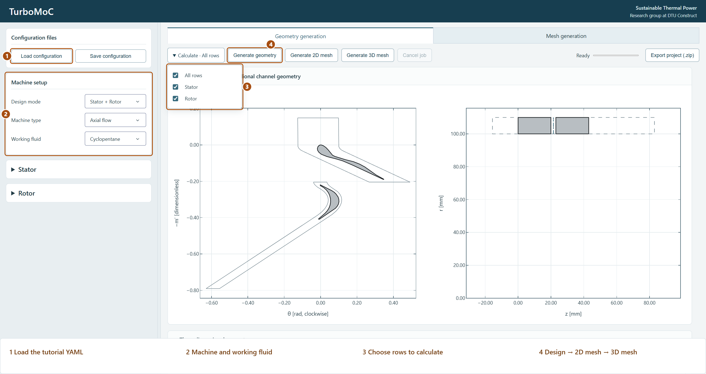

*Interface orientation, shown here with a completed design. Start by loading the case and checking machine setup, then follow the three calculation buttons in order.*

The sidebar contains inputs; the main area contains results. Expand **Stator** or **Rotor** to inspect each row's settings. Drag the divider beside the sidebar for more room. Commit an edited numerical value by pressing Enter or moving focus out of the field.

Three selectors have different purposes:

| Control | What it controls |
| --- | --- |
| **Design mode** | Which rows belong to the active machine and therefore to the required export. |
| **Calculate** | Which active rows the next calculation processes. **All rows** runs them sequentially in machine order. |
| **Configure display > Blade rows** | Check the rows to display and edit together. This selection is shared across geometry and mesh plots; calculation and export scope remain independent. |

## 3. Understand the stator settings

In **Geometry generation**, expand **Stator**. A stator is the stationary blade row: it expands and turns the flow before it enters the rotor. The MoC calculation provides the supersonic expansion contour used to construct its blade profile.

### Inlet state and expansion

Under **Method of characteristics**, check the following:

| Setting | Example value | Meaning |
| --- | --- | --- |
| **Inlet stagnation property pair** | `PQ` | Defines the inlet state using pressure and vapor quality. |
| Pressure | `251300` Pa | Stagnation pressure: the pressure associated with bringing the flow to rest isentropically. |
| Vapor quality | `0.025` | Vapor mass fraction: 0.025 means 2.5% vapor by mass. |
| **p back** | `95000` Pa | Target exit static pressure for the nozzle design. |
| **solver** | `conventional` | The selected MoC construction. |
| **n** | `15` | Resolution of the initial characteristic discretization. |

Leave **use true sauer line**, the geometric construction parameters, and marching controls unchanged initially. They affect nozzle construction; they are not mesh settings.

**Watch the units:** pressure is in Pa and temperature in K. The MoC inputs **y t**, **rho t**, and **rho d** are in **metres**; `rho t` and `rho d` are geometric radii, not densities. Blade/channel lengths and mesh lengths below use **millimetres**. The nozzle contour is scaled when forming the final blade, so its computational throat size is not the final machine passage size.

### Channel dimensions and blade shape

Under **Meridional channel definition**, the example specifies a **hub radius** of `100` mm, **blade height** of `10` mm, and **hub chord** and **tip chord** of `20` mm. The hub is the inner endwall; the shroud lies at radius 110 mm. Equal hub and tip chords give equal axial extents at both ends of the blade.

Under **Blade geometry definition**, the main controls are:

| Setting | Example value | Meaning |
| --- | --- | --- |
| **metal angle in** | `0`° | Inlet camberline direction. |
| **metal angle out** | `65`° | Camberline direction at the throat; also the angle used for stator-to-rotor inlet transfer. |
| **r trailing** | `0.5` mm | Rounded trailing-edge radius in the source blade template, before scaling to the channel chord. |
| **inlet opening ratio** | `1.3` | Pitch divided by passage inlet opening; influences the convergent blade section. |

Keep the spline and point-count controls unchanged for this walkthrough.

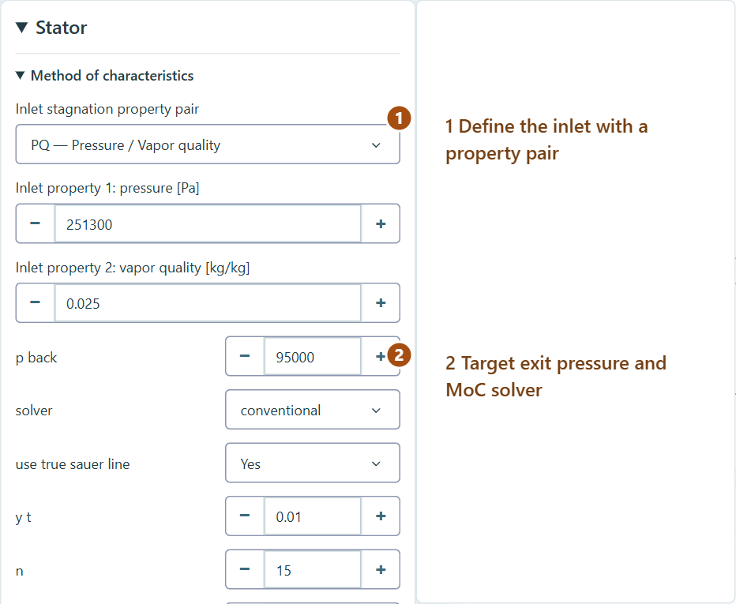

*Thermodynamic inputs determine the expansion; channel and blade controls determine the physical blade row.*

The saved **Actual number of blades** starts at `31` for both rows. After each successful blade-design calculation, the app sets it to the rounded-up **Natural number of blades (midspan)**. This natural count comes from the designed pitch-to-chord ratio and machine dimensions. You may override the integer afterward to change passage spacing; another explicit blade-design calculation applies the suggested count again. Use **Displayed blades** in the plot controls when you only want to show more or fewer copies.

### Flow domain and extensions

Expand **Flow domain definition** to control the passage around the blade. These settings are available for both stator and rotor:

| Control | What to choose |
| --- | --- |
| **Domain shift mode** | Keep **auto** initially, or select **manual** to position the periodic boundaries yourself. |
| **Domain shift value [pitch]** | Pitchwise shift as a fraction of pitch; used only in manual mode. |
| **Number of points** | Sampling of the domain curves. Mesh resolution is controlled separately in **Mesh generation**. |
| **Inlet / Outlet → Extension type** | Choose **Smooth B-spline** or **Straight line** independently at each end. The defaults are a smooth inlet and a straight outlet. |
| **Inlet / Outlet → Extension length [chords]** | Distance to the inlet or outlet, expressed in reference chord lengths. |
| **Inlet / Outlet → Axial tangent / Blade tangent** | Dimensionless tangent-handle lengths that shape a smooth extension. They have no effect on a straight extension. |

A straight extension continues the blade-reference tangent to the inlet or outlet plane. Changing extension type can move where the periodic boundaries meet that plane; inspect the resulting domain before meshing. For a connected stator–rotor pair, the app derives the two internal extension lengths from the inter-row gap, as described below.

Saved YAML files use the same nested **Inlet** and **Outlet** groups. Older flat flow-domain settings are converted when loaded. If extension types were omitted, choose **Smooth B-spline** at both ends to reproduce the earlier all-smooth construction.

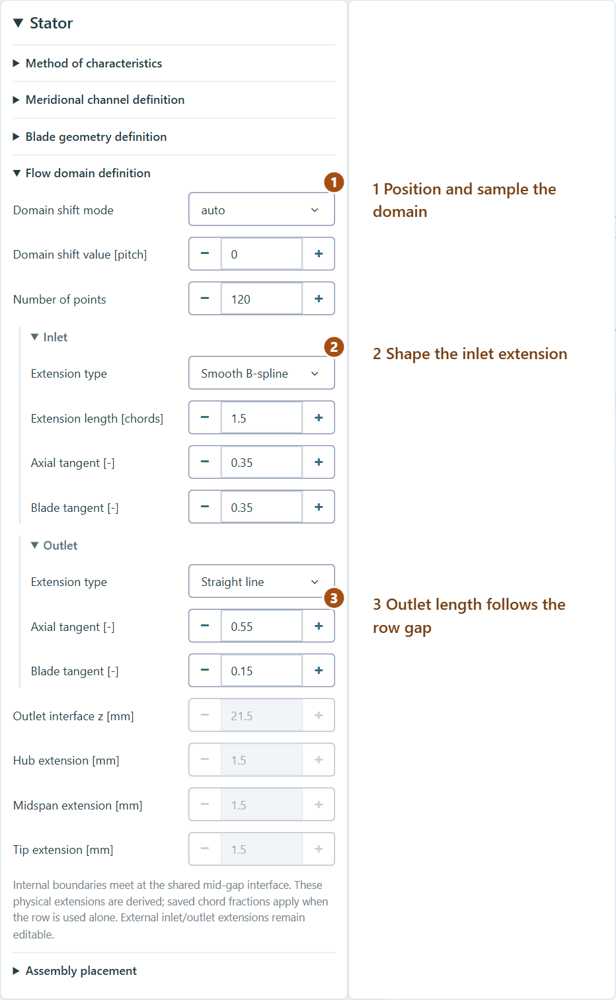

*The stator inlet remains editable. Its outlet meets the rotor at the shared interface, so the outlet lengths below the nested groups are calculated readouts.*

## 4. Understand the rotor and row connection

Expand **Rotor**. The rotor is the moving row, so its design uses velocity and Mach number relative to the blades.

Under **Rotor inlet state**, retain **Inlet conditions → Couple to stator exit**, **Rotational speed type → Actual speed [rpm]**, and speed `1000` rpm.

Read-only relative stagnation pressure, temperature, inlet Mach number, and inlet flow angle are initially pending. They become available after the current stator calculation converges. The app combines the stator exit velocity with the rotor blade speed at its inlet midspan radius: 105 mm for this example.

This coupling transfers the stator exit state ideally. It does not calculate flow or losses in the gap. Saved manual rotor pressure, temperature, Mach number, and angle are fallback inputs used only with **Specify manually**.

Under **Vortex blade design**, the main controls are:

| Setting | Example value | Meaning |
| --- | --- | --- |
| **M outlet** | `1.5` | Relative outlet Mach number. |
| **M lower** | `1.05` | Constant Mach number on the pressure-side arc. |
| **M upper** | `2.0` | Constant Mach number on the suction-side arc. |
| **num points** | `60` | Resolution of the transition arcs. |
| **le te ratio** | `25` | Target pitch divided by trailing-edge radius; larger values give a smaller relative edge radius. |

The outlet flow angle is derived from mass continuity. The vortex method requires a **supersonic relative inlet**, and the app also rejects negative relative inlet angles. If changing speed produces a warning, correct the speed or inlet conditions before calculating.

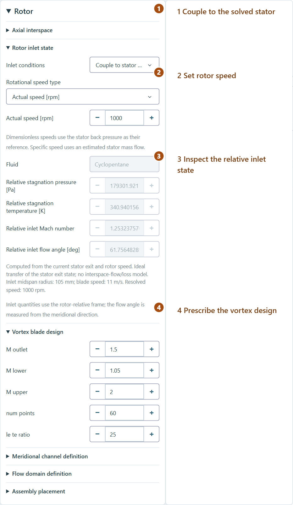

*Read-only inlet quantities are calculated from the upstream stator; they are not additional values to type.*

Under **Axial interspace**, `axial interspace mm = 3` places the rotor leading-edge plane 3 mm after the farthest stator trailing edge. With the example's 20 mm chords, the stator occupies axial positions 0–20 mm and the rotor 23–43 mm.

The flow domains meet halfway across this gap, at **21.5 mm**. Under **Flow domain definition**, internal extension lengths are derived readouts. The outer stator inlet and rotor outlet lengths remain editable. Saved stator `outlet.extension_length` and rotor `inlet.extension_length` values apply when those rows are used alone; extension type and tangent controls remain available in each group.

Keep matching hub radii and blade heights for this axial pair. The interface construction requires a positive gap and consistent endwalls.

## 5. Compute and inspect the blade design

1. Set **Calculate → All rows** and **Configure display > Blade rows > All rows**.
2. Click **Generate geometry** once.
3. Follow the job status and progress bar. The stator runs first; its result supplies the coupled rotor inlet.
4. Expand **Terminal · live activity** for calculation details or to investigate an error.

Wait until the queue finishes before meshing. **Cancel job** stops the active calculation and remaining queued work; previously successful results are retained.

In **Blade-to-blade and meridional channel geometry**, inspect blade profiles and the passage between neighboring blades. The meridional view shows radius against axial position, making channel dimensions and the inter-row gap easy to check.

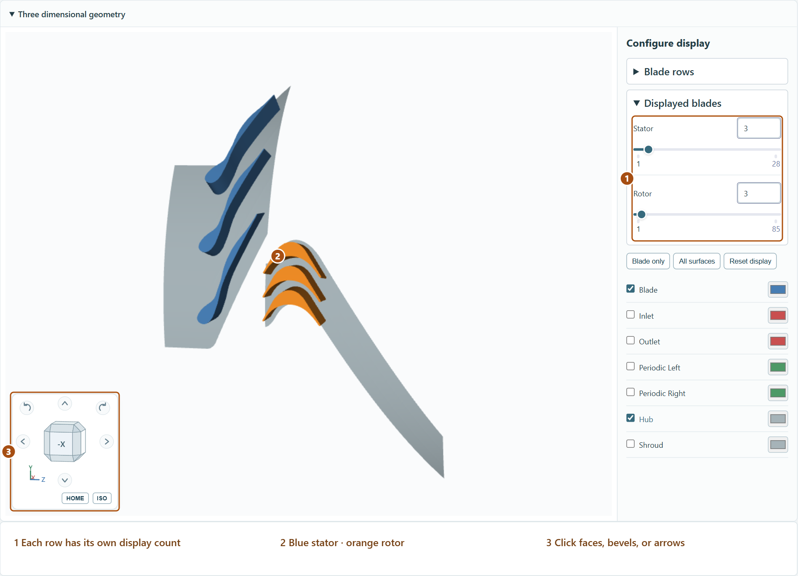

*Three display copies of each row: stator in blue and rotor in orange, with gray hub supports. The open **Displayed blades** menu shows independent counts; the orientation cube changes the camera direction.*

### Choose rows, blade copies, and surfaces

The **Configure display** panel sits to the right of each 3D plot. Expand **Blade rows** to check Stator, Rotor, or **All rows**. Expand **Displayed blades** to set each selected row's count with its own slider or number box. For an annular row, the range is one to that row's actual blade count; a linear cascade offers up to 25 display copies.

Surface controls apply to all checked rows. Select **Blade only** or **All surfaces**, or check individual boundaries. When selected rows have different settings, the controls show the first row's settings; an edit applies to every selected row. Blade-copy counts remain independent. **Reset display** restores each selected row's display defaults.

Default colors identify the surfaces:

| Surface | Default color |
| --- | --- |
| Stator blades | Blue |
| Rotor blades | Orange |
| Hub and shroud | Gray |
| Inlet and outlet | Red |
| Both periodic sides | Green |

Click a color swatch to customize it. Geometry and mesh views keep separate display settings. Changing copies or appearance does not change the physical blade count or exported mesh.

Both hub and shroud appear as smooth, continuous supports in the geometry view, including beneath the blade ends. Hide either surface to see the blades clearly. The mesh view shows the actual mesh boundaries.

### Orient the camera

Drag in a 3D plot to rotate; use the mouse wheel or drag with the right mouse button to zoom. The **orientation cube** at the bottom-left follows the camera. Click a face for an axis-aligned view, a beveled edge for a diagonal view, or a corner for an isometric view. Clicking **+X**, for example, looks from positive X toward the model. Surrounding arrows orbit in **30°** steps or roll the image in **15°** steps.

**HOME** restores the default orientation: slightly oblique with Z pointing right and Y up for an axial turbine, or looking along the Z shaft axis at the X–Y disk for a radial turbine. **ISO** selects an isometric view. In annular views, **Z follows the shaft**, **+Y follows positive-speed rotor motion at the reference passage**, and X completes the right-handed frame. Reversing the rotor speed does not flip the axes.

Camera shortcuts preserve zoom and the point you are looking at. With the cube focused, use the **arrow keys** to orbit, **Q/E** to roll, **Home** for the default orientation, or **I** for ISO. Geometry and mesh cameras are independent; changing the view does not change exported coordinates.

### Optional: stop at a standalone stator

To create a stator-only project, change **Design mode → Stator only**, then follow the mesh and export steps below. It is simplest to choose this immediately after loading the example, before calculating.

You can also change mode after inspecting the combined design. This restores the stator's standalone outlet extension, so regenerate its **2D** and **3D** meshes. Follow the enabled buttons if a prerequisite needs recalculating.

Choosing **Calculate → Stator** while retaining **Stator + Rotor** is useful for inspecting one row, but does not enable stator-only export: every active row must have a current mesh.

## 6. Generate and inspect the 2D mesh

Open **Mesh generation**, expand the desired row, and inspect **2D mesh · reference conformal mm**. An annular machine is first meshed in a flattened reference passage, then mapped through the physical channel to construct its 3D mesh. Reference-plane lengths are not universally equal to physical distances throughout the final annulus.

The blade-to-blade plot uses **θ [rad, clockwise]** and **−m′ [dimensionless]**; its axes are not physical millimetres. The meridional pane uses **z** and **r** in mm. It projects the section-boundary stations through the prescribed span grid and can appear before a 3D mesh has been generated. Solid outlines show blade extents; dashed outlines show the flow-domain extensions.

Both example rows use:

| Setting | Value | Purpose |
| --- | --- | --- |
| **blade size** | `0.25` mm | Target blade spacing; smaller values give finer surface resolution. |
| **domain size** | `1.0` mm | Target spacing away from the blade. |
| **curvature elements** | `50` | Curvature-based resolution; increasing it refines tightly curved regions. |
| **recombine** | **Yes** | Requests quadrilateral recombination. |
| **recombine minimum quality** | `0.1` | Minimum quality for recombined quadrilaterals; poor candidates remain triangles. |
| **inflation layers → enabled** | **Yes** | Adds thin cells next to the blade wall. |
| **first height** | `0.03` mm | Requested first wall-normal layer height. |
| **growth ratio** | `1.2` | Successive nominal layers grow by a factor of 1.2. |
| **thickness** | `1.0` mm | Allowance for the inflation stack. |

Leave algorithm and smoothing controls unchanged initially. With **Calculate → All rows**, click **Generate 2D mesh** and wait for both rows.

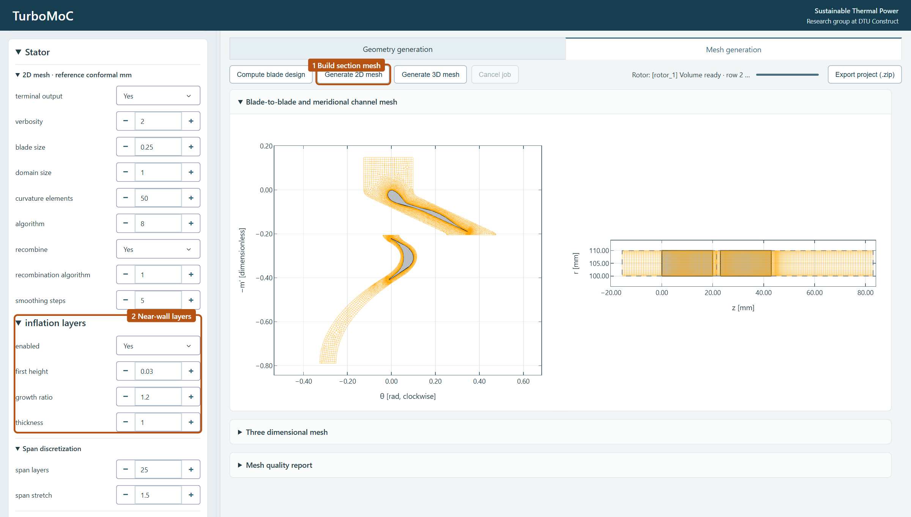

*Inspect the whole passage before zooming into its most demanding regions.*

**Recombine minimum quality** accepts values from 0 to 1. Increasing it can leave more triangles where a quadrilateral would have poor shape. This is Gmsh's recombination quality, not a skewness limit; inspect the final mesh as well. The default is `0.1`, including when omitted from older YAML files. Use `0.01` if you need the former Gmsh default.

### Inspect the inflation layers

Use **Configure display > Blade rows** to check only **Stator** or **Rotor** and isolate that row. Hover over the 2D plot to reveal its toolbar, then use box zoom to select a relatively straight blade surface. Double-click the plot to reset the view. Look for thin wall-adjacent cells, increasing spacing through the inflation region, and a transition toward the coarser passage mesh.

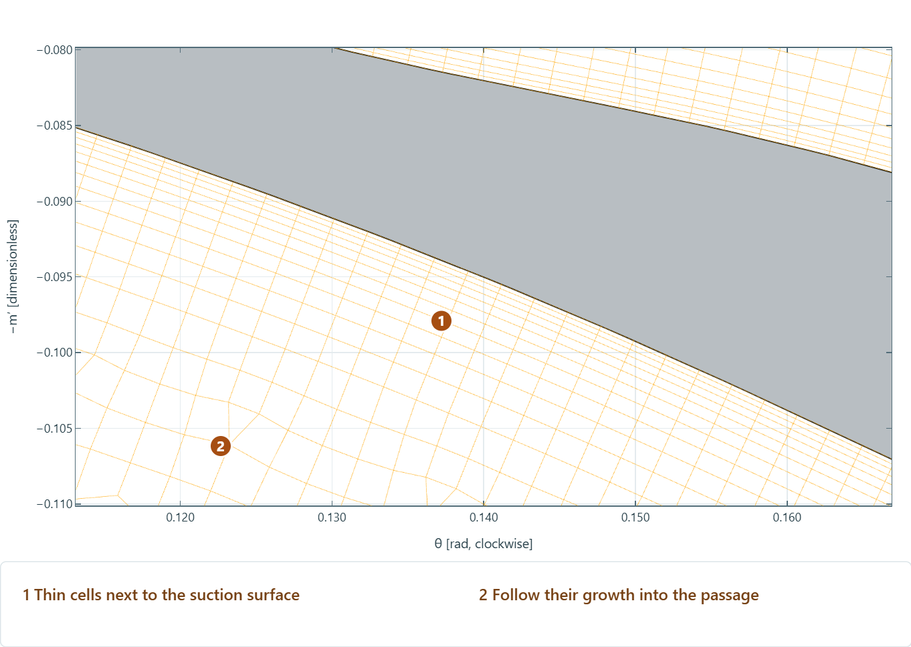

*First height controls the smallest wall-normal spacing; growth ratio and thickness control how it expands away from the blade.*

Thickness is an allowance, not a promise of an identical stack everywhere: curvature and nearby boundaries can shorten or merge layers. First height is a meshing input, not a verified CFD wall-resolution target such as a prescribed wall y-plus.

### Inspect the trailing edge

Zoom into the rounded trailing edge. Look for adequate points around the curve, orderly inflation cells around the turn, and a smooth transition into the wake region.

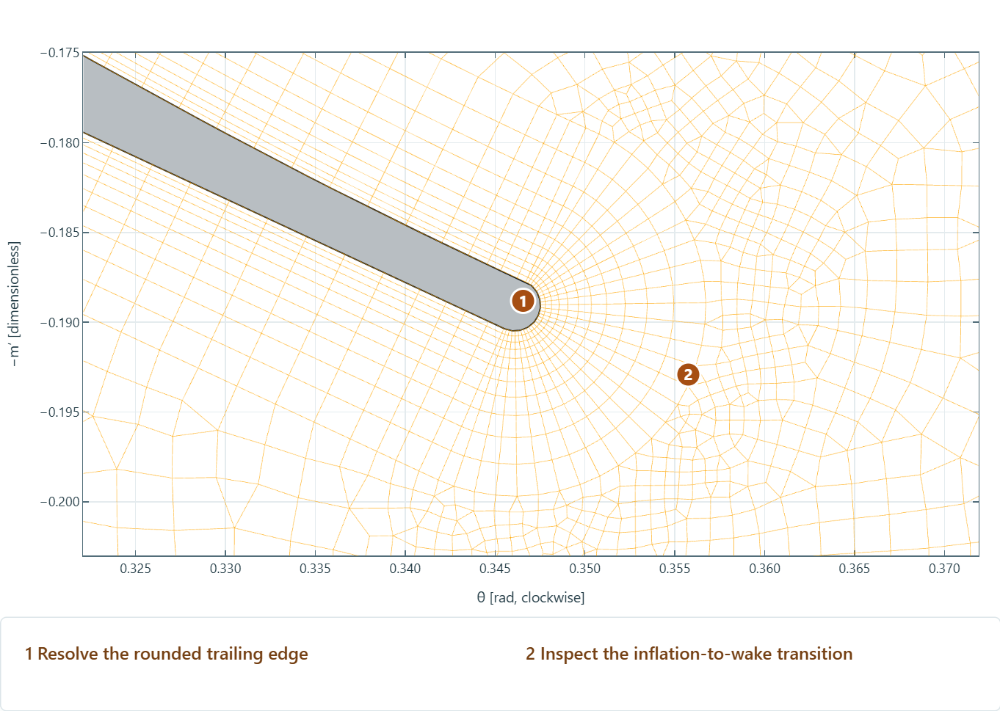

*The close-up reveals how the rounded geometry is represented, which can be difficult to judge from the whole passage.*

Distinguish shape from resolution: **r trailing** or the rotor's **le te ratio** changes the blade geometry; **curvature elements** and **blade size** change its mesh representation. After a sizing edit, regenerate the 2D mesh before generating the 3D mesh.

## 7. Generate and explore the 3D mesh

Under **Span discretization**, retain **span layers = 25** and **span stretch = 1.5**. Span layers divide the distance from hub to shroud. Positive stretch clusters stations toward both endwalls; zero gives uniform spacing. This is separate from blade-wall inflation.

Click **Generate 3D mesh**. The app maps and sweeps the section mesh through the channel, checks the resulting cells, and prepares the report.

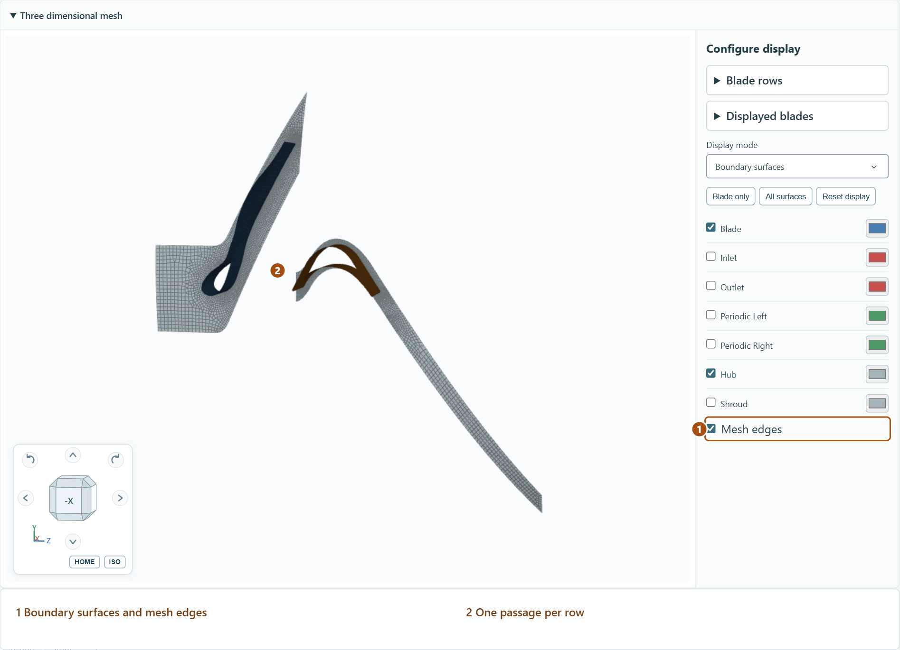

*The 3D viewer shows boundary surfaces of the volume mesh. Blade and hub surfaces expose the spanwise discretization and the relationship between row passages.*

In **Configure display**, select **Blade rows** and adjust each row's **Displayed blades** count. One copy makes local details easier to inspect; several copies show the annular arrangement. Counts apply in all three **Display modes**:

| Display mode | Use it to |
| --- | --- |
| **Boundary surfaces** | Inspect the passage shape, individual boundaries, and mesh edges. |
| **Mesh quality filter** | Locate the worst cells or cells beyond a quality threshold. |
| **Spanwise layer** | Inspect one complete cell layer at a time, from hub to shroud. |

### Boundary surfaces

Turn **Mesh edges** on and show **Blade** and **Hub** first. Hide **Shroud** or other outer surfaces if they obscure the interior. Add **Inlet**, **Outlet**, and periodic boundaries to understand the passage. Surface checkboxes and color pickers follow the same controls as the geometry view.

### Locate poor-quality cells

The quality filter reveals cells that boundary surfaces can hide. Start with one row and one displayed blade so repeated passages do not obscure the region you want to inspect:

1. Under **Blade rows**, check **Rotor** only. Set its **Displayed blades** count to `1`.
2. Select **Display mode → Mesh quality filter** and **Metric → Skewness**.
3. Select **Worst N** and enter `100` in **Number of cells**. This locates a small set of cells with the highest skewness. Increase the number if you need to see the surrounding pattern.
4. Expand **Transparent surfaces**. Initially all surfaces are checked. To reproduce the screenshots, keep only **Blade** checked and zoom toward the blade region; add other boundaries when you need more passage context.
5. Rotate and zoom around the colored cells. Check whether they are isolated or form a band near a blade, an endwall, a periodic side, or an extension transition.

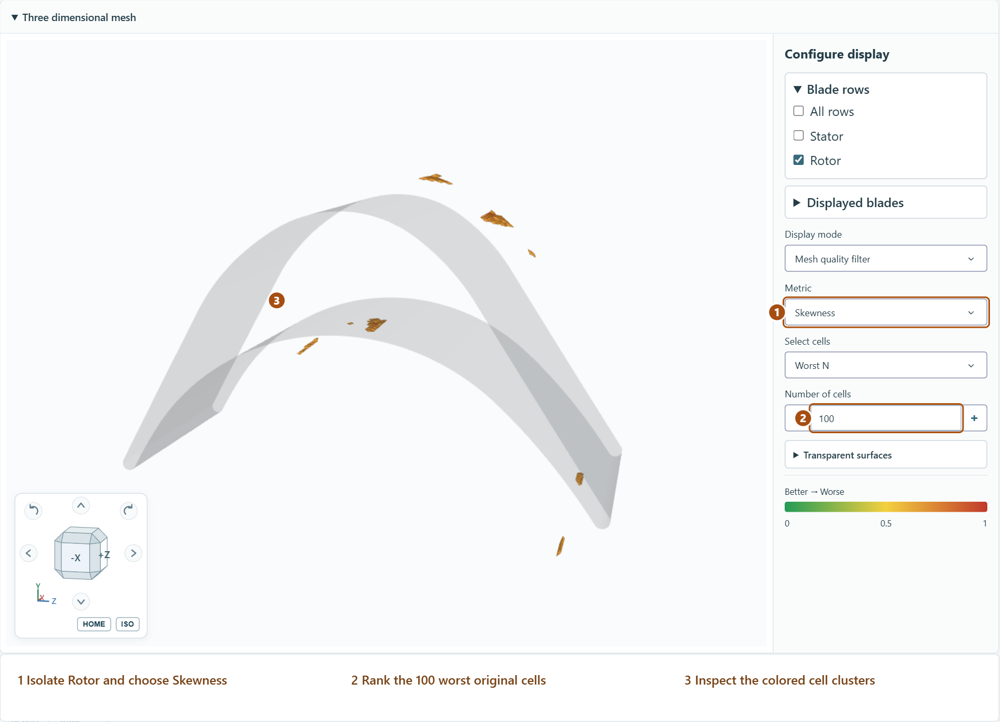

*The 100 worst rotor cells ranked by skewness. The faint gray blade provides location; only the selected volume cells carry quality colors.*

In this tutorial run, the rotor has **nine cells with skewness above 0.8**. **Worst N = 100** includes those cells and the next highest-ranked cells, making the broader pattern easier to inspect. Most of the selected cells lie toward the hub, with others elsewhere in the span, including near the shroud. A larger N adds cells by quality rank; it does not select their geometric neighbors automatically.

Repeat with **Orthogonality** to locate the cells with the lowest values. These need not be the same cells as those ranked worst by skewness. With several rows selected, **Worst N** selects up to N original cells **in each row**, rather than N cells across the stage. Displayed blade copies repeat this selection; they do not create additional samples or change the statistics.

### Use a threshold to reveal the extent of a problem

Switch **Select cells → Threshold** when you want to see every cell beyond a chosen limit. With **Rotor** selected, choose **Metric → Orthogonality** and set **Orthogonality ≤** to `0.5`. This selects **81 cells** in the tutorial run. No cells in either row fall below the report's 0.2 orthogonality flag, so raising the viewer cutoff to 0.5 reveals the rotor's lower-orthogonality region for closer inspection. The label beside the input shows the comparison direction:

| Metric | Cells selected by a threshold | Better → worse |
| --- | --- | --- |
| **Skewness** | Values at or above the threshold | 0 → 1 |
| **Orthogonality** | Values at or below the threshold | 1 → 0 |
| **Edge aspect ratio** | Values at or above the threshold | 1 → larger values |

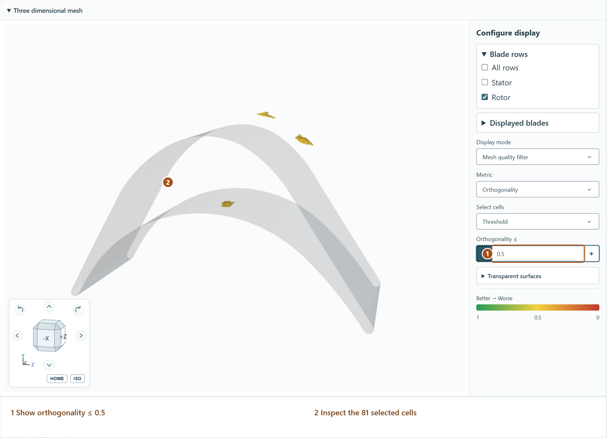

*The 81 rotor cells with orthogonality ≤ 0.5. A threshold answers “where are all cells beyond this value?” Its selection can grow, shrink, or become empty as the mesh changes.*

Here the selected cells occupy the first seven layers from the hub, around 40–73% of the axial blade chord, near the transition from inflation cells to the passage mesh. This points to a useful region for layer-by-layer inspection. It does not by itself establish which setting should change.

To see more surrounding cells, lower the skewness or aspect-ratio threshold, or raise the orthogonality threshold. An empty selection means no cells meet that criterion; use **Boundary surfaces** to confirm the row is visible. Neither the default thresholds nor red coloring constitute a universal CFD acceptance rule.

The single colorbar inside **Configure display** runs from green through yellow to red. It uses the metric's scale, not the rank within the selected cells: the worst 100 cells in a good mesh may still appear green or yellow. Skewness and orthogonality keep their full 0–1 scales. Edge aspect ratio uses a logarithmic scale from 1 to a rounded upper value covering the selected row meshes. The same scale applies to all displayed rows; selecting different rows can change the aspect-ratio upper limit.

Large aspect ratios can be intentional in thin wall-adjacent cells. Inspect their location and the other metrics before interpreting a large ratio as a defect. **Transparent surfaces** is independent of the surface selection in **Boundary surfaces** mode.

### Inspect the interior one layer at a time

Switch to **Spanwise layer** after locating a suspect region. This reveals its surroundings even when those cells did not pass the quality filter:

1. Retain one row and one displayed blade, then choose **Display mode → Spanwise layer**.
2. Choose **Metric → Skewness** to compare with the Worst N view above. When following a different metric, retain it in both views so their colors remain comparable.
3. Move the slider to **Layer 13 of 25**, at **50.0% span**, to reproduce the middle-layer view below. Move toward **Hub** or **Shroud/tip**, or use **Previous** and **Next** for one-layer steps.
4. Compare an endwall layer with a middle layer. Follow the same region through successive layers to see whether poor quality is confined to one part of the span or persists through it.
5. Use **Transparent surfaces** to keep a blade outline for orientation while hiding any endwall or periodic surface that blocks the view.

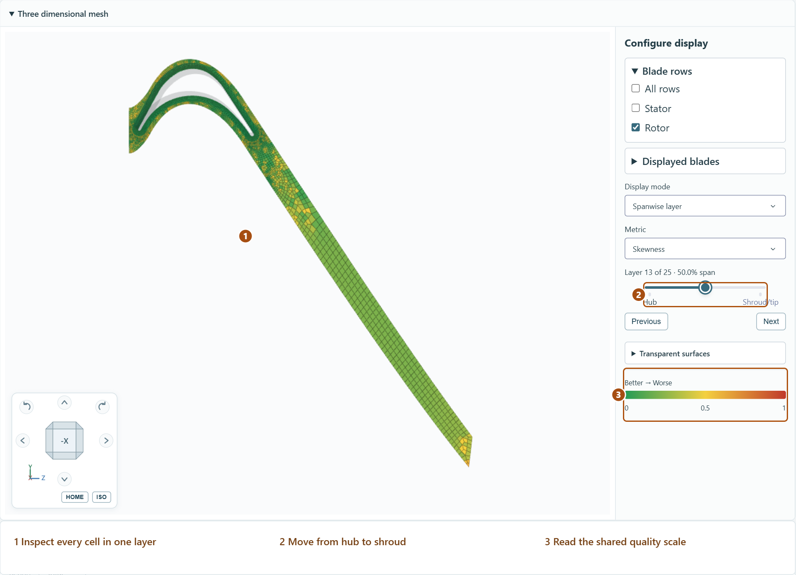

*The complete middle rotor layer, colored by skewness. Better cells remain visible around the less favorable regions; the threshold filter is inactive.*

Zoom into the blade and inflation region, then keep the same camera and **Skewness** metric while changing the layer. Comparing the same region at midspan and near the hub makes spanwise differences easier to recognize:

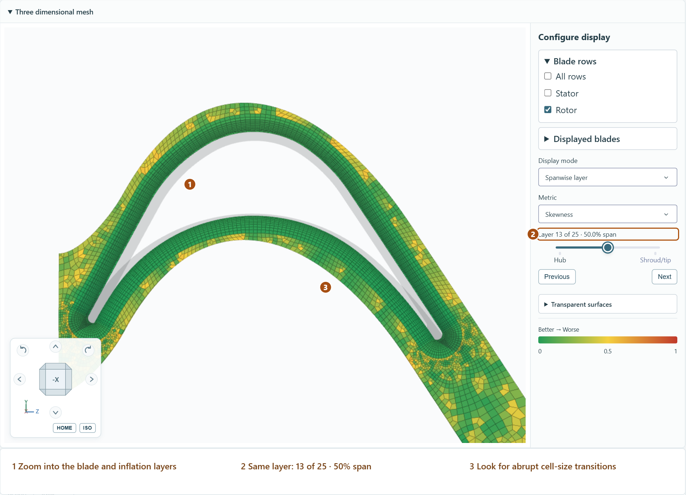

*Layer 13: a closer view of the blade and surrounding cells at 50.0% span.*

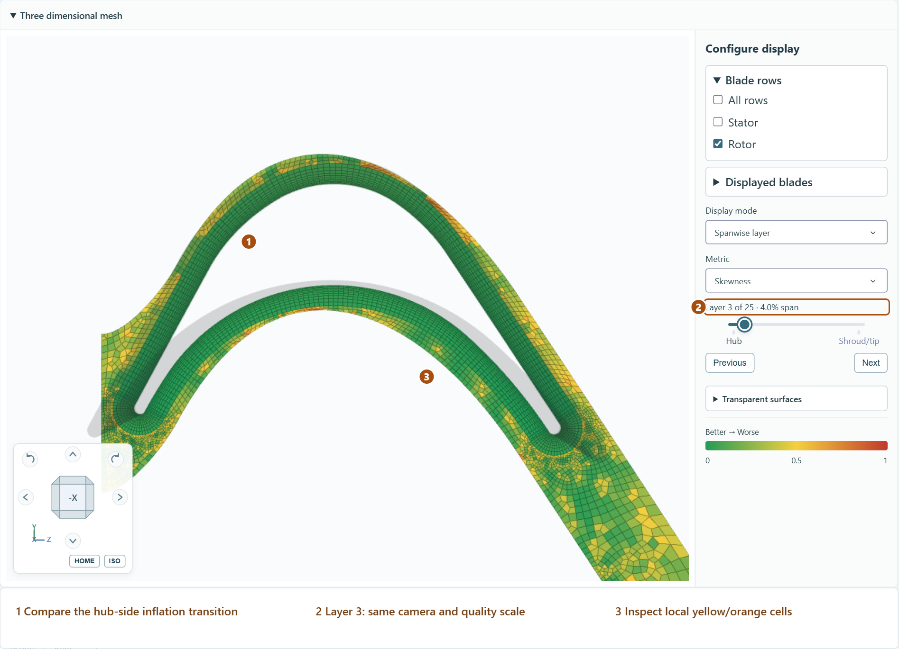

*Layer 3 of 25, at **4.0% span**: the same region near the hub. The camera and color scale are retained so changes in cell quality can be compared directly.*

The caption shows **Layer … of …** and the layer midpoint as a percentage of hub-to-shroud span. Stretched layers have unequal thickness, so equal slider steps need not give equal percentage changes. This is one complete layer of original **3D volume cells**, not a newly meshed 2D section or an arbitrary cutting plane; the colors remain their original 3D quality values. The quality threshold is inactive in this mode.

With several rows selected, the app aligns layers by span position even if their layer counts differ. The slider and caption follow the first selected row. Check smooth spanwise progression and the intended interface location; coincident interface positions do not imply matching nodes or a connected fluid solution.

### Turn observations into a mesh change

Use location as a clue, then change one input group at a time:

| What you see | What to inspect next |
| --- | --- |
| A cluster around a leading or trailing edge | Zoom into the **2D mesh** and examine curvature resolution, blade spacing, and how inflation cells turn around the edge. |
| A band where inflation meets the passage mesh | Compare **growth ratio**, **thickness**, and **domain size** with the 2D transition. |
| Poor cells near a domain extension or periodic side | Inspect the domain shape and extension settings together with local mesh spacing. |
| Quality changes strongly toward hub or shroud | Compare adjacent layers, the meridional channel shape, and **span layers / span stretch**. |
| High aspect ratio in thin wall-adjacent cells | Cross-check skewness and orthogonality; establish whether the anisotropy is intentional for the intended calculation. |

These observations suggest where to investigate; they do not uniquely identify a cause. After a 2D sizing change, regenerate the **2D mesh**, then the **3D mesh**. Changing only **span layers** or **span stretch** requires a new 3D mesh. Compare the report and repeat the same inspection view after regenerating. Display mode, colors, surfaces, copies, camera orientation, and edge widths do not require remeshing.

## 8. Read the mesh quality report

Expand **Mesh quality report**. Set **Report → Total** for a stage overview, then select **Stator** or **Rotor** for an individual row. This selector is independent of **Blade rows**: hiding the rotor in a plot does not remove it from the total report. Quality filters and layer selections also leave the report unchanged.

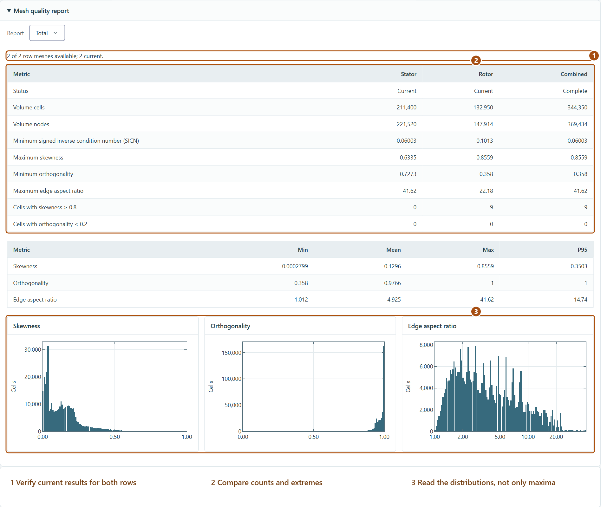

*The total report compares the rows and combines their actual cell samples. Check status and tail counts before using the plots to locate the affected regions.*

### Check status, size, and the worst values

1. **Status:** every active row should be **Current**. Reports can still show older meshes; heed **Outdated** or **Unavailable** labels.
2. **Volume cells / Volume nodes:** counts describe one generated passage per row. Displayed blade copies do not multiply statistics. Combined node counts sum rows without merging interface nodes.
3. **Minimum signed inverse condition number (SICN):** values near zero indicate poor or degenerate shape; negative values indicate inversion. Thin inflation cells can have low positive SICN.
4. **Maximum skewness / Minimum orthogonality / Maximum edge aspect ratio:** compare the row columns to decide where to start visual inspection. A single extreme does not tell you how much of the mesh is affected.
5. **Threshold counts:** compare **Cells with skewness > 0.8** and **Cells with orthogonality < 0.2** with each row's volume-cell count. A fixed number of flagged cells can represent very different fractions of differently sized meshes.

The threshold counts are inspection flags, not universal acceptance criteria. The report uses strict comparisons (`>` and `<`); the viewer includes equality (`≥` and `≤`), so cells exactly at the threshold can explain a difference between its selection and the report count.

For the run shown in these screenshots, the report reads:

| Quantity | Stator | Rotor |
| --- | --- | --- |
| Volume cells | 211,400 | 132,950 |
| Volume nodes | 221,520 | 147,914 |
| Maximum skewness | 0.6335 | 0.8559 |
| Minimum orthogonality | 0.7273 | 0.3580 |
| Maximum edge aspect ratio | 41.62 | 22.18 |
| Minimum SICN | 0.06003 | 0.1013 |
| Cells with skewness > 0.8 | 0 | 9 |
| Cells with orthogonality < 0.2 | 0 | 0 |

The combined mesh contains **344,350 cells** and **369,434 nodes**. The rotor's nine high-skewness cells account for about **0.0068% of its cells**: a small population worth locating, rather than evidence that the whole rotor mesh has similarly high skewness. Its worse skewness and orthogonality extremes make it a useful starting point for the filter walkthrough. The stator has the larger maximum aspect ratio, illustrating why the metrics should be considered together. These numbers describe this run; they are not target values or a mesh-acceptance certificate.

### Read the statistics and histograms together

| Metric | Interpretation |
| --- | --- |
| **Skewness** | Maximum equiangular face skewness per cell; 0 is ideal and 1 is degenerate. Inspect the maximum and high-value tail. |
| **Orthogonality** | Worst face-normal/centroid-connector alignment in each cell; 1 is ideal. Inspect the minimum and low-value tail. |
| **Edge aspect ratio** | Longest cell edge divided by shortest; 1 means equal edge lengths. Thin inflation cells naturally have larger ratios. |

The statistics table contains **Min**, **Mean**, **Max**, and **P95**. The mean describes the overall population and can conceal a small poor-quality tail. P95 is the 95th percentile: approximately 95% of cell values lie at or below it. For skewness and aspect ratio, compare P95 with the maximum to distinguish a broad high-value population from a few extreme cells. For orthogonality, P95 describes the *high*, usually better end of the distribution; use the **minimum** and low-value tail to diagnose poor cells.

Each histogram bar counts cells in a metric interval; its height is **Cells**, not a percentage or cell volume. Hover for the plotted metric value and count. Skewness and orthogonality use equal-width intervals from 0 to 1. The aspect-ratio axis and its intervals are logarithmic: equal horizontal distances represent multiplicative changes. Look to the **right** for poor skewness or large aspect ratios, and to the **left** for poor orthogonality.

Combined means, percentiles, and histograms pool all cells from the available row meshes. A larger mesh therefore contributes more samples; the combined mean is not a simple average of the row means. If a row is unavailable or outdated, the status message tells you why the displayed total is incomplete or includes older results.

### Investigate one row and retain a traceable record

Choose **Report → Rotor** to follow the regions shown in the inspection screenshots, or **Stator** to inspect the other row. The individual report adds its span-layer count and mesh-generation time, and lets you expand **Worst cells · original Gmsh IDs**.

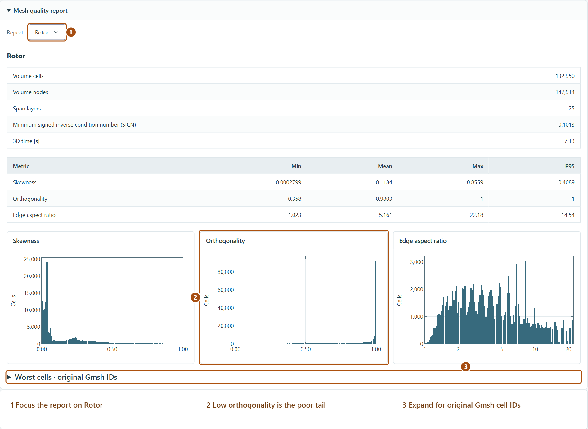

*The rotor report separates its distribution from the stage total. The worst-cell list records original mesh element IDs and their metric values.*

The worst-cell list includes up to ten cells per metric. Use the same row and metric in **Mesh quality filter → Worst N** to inspect the corresponding worst region; rankings can include tied values. IDs belong to that row's saved mesh and may change after remeshing, so keep the exported mesh and report together if you need to investigate an element later. They are not displayed-blade numbers.

A useful review sequence is **total report → individual row → quality filter → spanwise layers → revised mesh → report again**. Record both the new extremes and the size of the affected tail: moving one worst cell is different from improving a broad region. Hover over metric labels for definitions; these geometric measures may differ from a CFD solver's metrics. Successful mesh generation alone does not establish suitability for a particular CFD calculation.

## 9. Save settings and export the project

Click **Save configuration** to download the current YAML, including adjusted physical blade counts and the nested inlet/outlet settings. Displayed copies, colors, camera positions, and inspection selections are not saved. Loading the YAML restores inputs; recompute the design and meshes when reopening it.

For this axial case, **Export project (.zip)** becomes available when every active row has a completed, current **3D mesh** and no job is running. A 2D annular reference mesh alone is not the final physical CFD deliverable. Neither **Calculate** nor the **Blade rows** display selection narrows export scope.

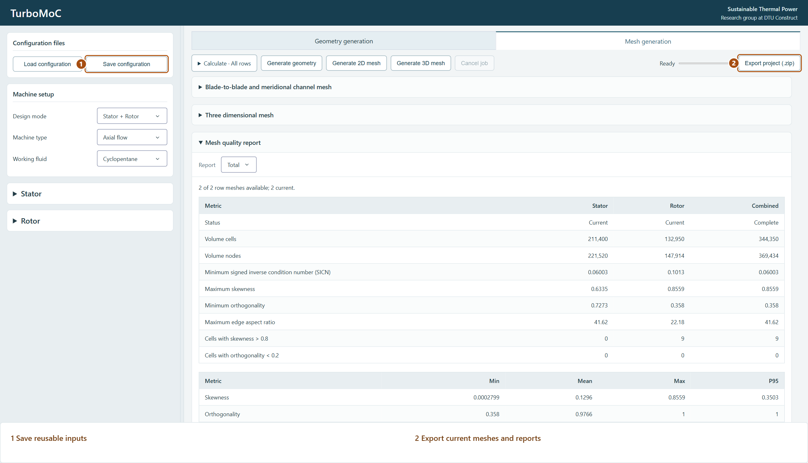

*Export after reviewing current mesh status. Keep settings and reports with the meshes.*

The archive contains:

| File | Purpose |
| --- | --- |
| `project.yaml` | Final configuration for reproducing the design. |
| `stage.cgns` | Complete active machine, with a separate fluid zone for each row. |
| `meshes/stator_1/`, `meshes/rotor_1/` | Individual row CGNS exports. |
| `mesh_report.json` | Summaries, quality data, interfaces, and effective coupled rotor inputs. |
| `activity.log` | Logs of the included meshes and preceding calculations. |
| `README.txt` | Contents, coordinates, boundaries, and downstream-use notes. |

The example's **CGNS mesh output → length scale = 0.001** converts millimetres to metres. Multirow meshes include assembly placement. Each row contributes **one periodic passage**, regardless of displayed copies.

In a CFD solver, check units and assign inlet/outlet conditions, walls, periodic pairing, rotor motion, and the stator–rotor interface. The archive preserves separate interface sides; it does not select a mixing-plane, sliding-mesh, or other flow-interface model. Consult its `README.txt` for import details. True 2D CGNS export is available for linear cascades; axial and radial exports use physical 3D meshes.

## 10. Make changes and recover from common problems

Change one group of settings at a time, using the example as your baseline.

| Situation | Next step |
| --- | --- |
| Calculation button disabled | Read validation messages and hover over the **Calculate** control for its prerequisite note. Correct invalid inputs or complete the preceding stage. |
| Coupled rotor inlet pending | Complete the current stator design before running the rotor alone, or use **All rows** for blade design. |
| Rotor inlet warning | Adjust speed or inlet conditions until the supported relative inlet is recovered. |
| Interface or clearance error | Check positive gap, matching endwalls, and space for the inflation thickness. |
| Outdated mesh | Regenerate the affected chain. A new explicit blade solve invalidates downstream meshes even with unchanged inputs. |
| Export unavailable | Check all active rows, not only the visible/calculated row, have current 3D meshes. |
| Calculation fails | Read **Terminal · live activity**, correct the reported input, and rerun the affected stage. |
| No cells visible in the quality filter | Check **Blade rows**, then increase **Number of cells** or relax the threshold. Switch to **Boundary surfaces** to see the complete passage. |
| Interior hidden by gray surfaces | Open **Transparent surfaces** and uncheck the boundaries blocking your view. |
| “Application source changed” | Restart the app after a code update, reload your saved configuration, and recompute. |

For more background, see [nozzle design](theory/nozzle_design.md), [stator design](theory/stator_design.md), [notation and units](theory/notation.md), and [rotor design by the vortex-flow method](theory/rotor_design.md).

---

*All screenshots were captured on 2026-10-13 from the current app after recomputing `examples/apps/cases/stator_rotor.yaml`. The design calculation selected 28 stator blades and 85 rotor blades. Camera framing, displayed copies, and visible surfaces vary to illustrate each task; the underlying meshes are the same throughout. Save the exported configuration to record the settings used for your own run.*
